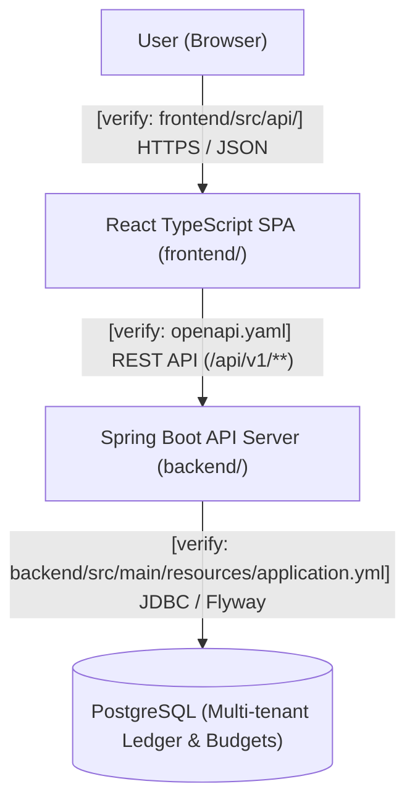

# docs/ARCHITECTURE.md — System Architecture

## System Overview

Diagram based on static analysis and greenfield target design only — runtime behavior unverified.

- **User (Browser)**: Interacts with the monthly budget grid, account registers, and reconciliation workflows.
- **React TypeScript SPA (`frontend/`)**: Renders the zero-based budgeting grid and account ledgers, formatting integer milliunits at the UI layer and managing optimistic cell updates.
- **Spring Boot API Server (`backend/`)**: Enforces tenant isolation (`budget_id`), executes transactional double-entry/envelope budget math, and serves `/api/v1/**` endpoints.
- **PostgreSQL**: Relational source of truth for budgets, accounts, category groups, categories, monthly category allocations, and split/transfer transactions.

## Data Flow

1. **Client Mutation (`User` → `SPA` → `API`)**: When a user assigns money to a category or records a transaction in `frontend/`, the UI converts user input into integer milliunits and sends a JSON request (`POST`/`PATCH`) to `backend/` under `/api/v1/budgets/{budgetId}/...` (`[verify with maintainers]`).
2. **Tenant & Auth Guard (`API`)**: Spring Security validates the bearer token/session and verifies that `{budgetId}` belongs to the authenticated user before entering the domain service (`[verify with maintainers]`).
3. **Transactional Ledger & Envelope Calculation (`API` → `DB`)**: Inside an `@Transactional` boundary, the backend persists the allocation or transaction row in PostgreSQL, updates any paired transfer or credit-card payment category movement, and recomputes the monthly rollup (`Assigned`, `Activity`, `Available`, `ReadyToAssign`).
4. **Authoritative State Response (`API` → `SPA`)**: The API returns the updated resource and affected monthly summary in integer milliunits (`_milliunits`), allowing the React query cache to reconcile optimistic state across the active and subsequent months.

## Key Components

### Level 2 — Containers

#### React TypeScript SPA (`frontend/`)

- **Role**: Delivers the interactive monthly budget worksheet, account transaction registers, and reporting views.
- **Interfaces**: Communicates with `backend/` via JSON over HTTPS (`openapi.yaml` contract).
- **Constraints**: [INVARIANTS.md §API Contract](../INVARIANTS.md#api-contract), [INVARIANTS.md §Code Quality](../INVARIANTS.md#code-quality)
- **Gotcha**: Must never store or compute currency as floats; see [frontend/AGENTS.md](../frontend/AGENTS.md).

#### Spring Boot API Server (`backend/`)

- **Role**: Owns authentication, tenant authorization, transactional ledger mutations, and zero-based envelope budgeting calculations.
- **Interfaces**: Exposes REST endpoints under `/api/v1/**` (`openapi.yaml`) and connects to PostgreSQL over JDBC.
- **Constraints**: [INVARIANTS.md §Security](../INVARIANTS.md#security), [INVARIANTS.md §Data Integrity](../INVARIANTS.md#data-integrity), [INVARIANTS.md §Performance](../INVARIANTS.md#performance)
- **Gotcha**: Monthly `Available` and `ReadyToAssign` depend on prior months' rollover and cash vs. credit overspending rules; see [AGENTS.md §Known Footguns](../AGENTS.md#known-footguns).

#### PostgreSQL Database

- **Role**: Stores persistent relational state for users, budgets, accounts, categories, monthly allocations, and transactions.
- **Interfaces**: Accessed exclusively by `backend/` via JDBC connection pool and managed via Flyway migrations (`backend/src/main/resources/db/migration/`).
- **Constraints**: [INVARIANTS.md §Data Integrity](../INVARIANTS.md#data-integrity)
- **Gotcha**: All monetary columns must use `BIGINT` (milliunits); schema changes must go through versioned Flyway SQL files.

### Level 3 — Components

#### `backend/` → Budget Calculation Engine

- **Role**: Computes monthly category `Assigned`, `Activity`, `Available`, credit card payment funding transfers, and budget-wide `ReadyToAssign` across month boundaries.
- **Interfaces**: Invoked by Budget and Transaction domain services within `@Transactional` boundaries.
- **Constraints**: [INVARIANTS.md §Data Integrity](../INVARIANTS.md#data-integrity), [INVARIANTS.md §Performance](../INVARIANTS.md#performance)
- **Gotcha**: Cash overspending in Month `M` reduces `ReadyToAssign` in Month `M+1`, whereas credit card overspending increases unbacked credit debt without reducing `ReadyToAssign`.

#### `backend/` → Transaction & Reconciliation Ledger

- **Role**: Manages regular transactions, split transactions (`subtransactions`), account-to-account transfers, and cleared/reconciled status transitions.
- **Interfaces**: Invoked by Transaction and Account controllers/services; writes to `transactions` and `subtransactions` tables.
- **Constraints**: [INVARIANTS.md §Data Integrity](../INVARIANTS.md#data-integrity)
- **Gotcha**: Account transfers consist of two linked legs (`transfer_account_id` / `transfer_transaction_id`) whose milliunit amounts must always be exact additive inverses (`+X` and `-X`).

## Performance Characteristics

- **SLA targets**: see [INVARIANTS.md §Performance](../INVARIANTS.md#performance)
- **Known bottlenecks**: Monthly budget rollup across many historical months if computed via per-category N+1 queries; mitigate with bulk SQL aggregation per `(budget_id, month)`.
- **Unmeasured paths**: `[TBD — measure in staging]`

## Security Architecture

- **Credential management**: Secrets (`DB_PASSWORD`, `JWT_SECRET` `[verify with maintainers]`) are injected via environment variables locally (`.env`) and secret managers in deployment; never committed to Git.
- **Session handling**: Stateless JWT bearer tokens or HTTP-only session cookies validated on every `/api/v1/**` request (`[verify with maintainers]`).
- **Data protection**: TLS in transit; strict row-level tenant scoping by `budget_id` on every repository query; BCrypt password hashing.
- **Sensitive operations**: Password resets, budget deletion, and account reconciliation unlocking require explicit confirmation and audit logging.

## Deployment

- **Topology**: Containerized web + API + PostgreSQL (`docker-compose.yml` locally; horizontally scalable stateless API containers in production).
- **Load balancing**: Reverse proxy / ingress routing `/api/**` to Spring Boot and static/SPA routes to Frontend.
- **State stores**: PostgreSQL (primary transactional store).
- **Scaling model**: Stateless `backend/` instances scale horizontally; database concurrency coordinated via PostgreSQL transactions and optimistic locking.

## Configuration Layers

| Layer | File / Directory | Purpose | Controls | Read by |
|---|---|---|---|---|
| 1 (Defaults) | `backend/src/main/resources/application.yml` `[verify with maintainers]` | Base Spring Boot, JPA, and Flyway configuration | Datasource defaults, Flyway path, logging | `backend/` |
| 2 (Profile) | `backend/src/main/resources/application-dev.yml` `[verify with maintainers]` | Local development overrides | Local DB URL, verbose SQL logging, CORS | `backend/` |
| 3 (Environment) | `.env` (from `.env.example`) | Environment-specific secrets and ports | `POSTGRES_DB`, `POSTGRES_USER`, `POSTGRES_PASSWORD`, `VITE_API_BASE_URL` `[verify with maintainers]` | `docker-compose.yml`, `backend/`, `frontend/` |
