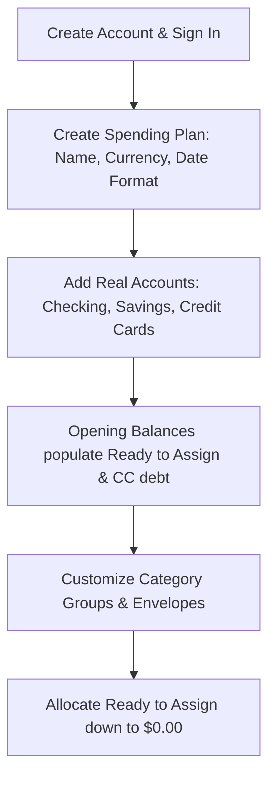
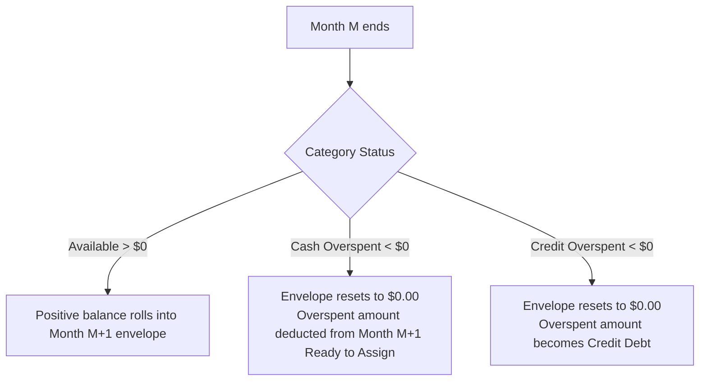

# docs/BEHAVIOR.md — User Interaction & Behavioral Specification

This document details how an end user experiences and interacts with **YNABx**. It serves as the canonical behavioral specification for designers, frontend engineers, backend developers, and AI agents building and extending user-facing features.

---

## 1. Core Philosophy & Mental Model

> **Official YNAB Reference**: [The Four Rules of YNAB](https://www.ynab.com/the-four-rules)

YNABx is built on **Zero-Based Envelope Budgeting** and the **Four Rules of YNAB**:

1. **Rule 1: Give Every Dollar a Job**: When money enters the user's possession, they allocate every single cent into purposeful category envelopes until **Ready to Assign** equals exactly `$0.00`. The user never plans with money they don't yet have in the bank.
2. **Rule 2: Embrace Your True Expenses**: Large, irregular expenses (car insurance, holiday gifts, annual subscriptions) are broken down into predictable monthly savings targets.
3. **Rule 3: Roll With the Punches**: When life happens and a category is overspent, the user addresses it immediately by reallocating money from another envelope. Overspending is treated as a trade-off, not a failure.
4. **Rule 4: Age Your Money**: By consistently spending less than earned, the user gradually builds a buffer until they spend money earned 30+ days ago (breaking the paycheck-to-paycheck cycle).

---

## 2. Onboarding & First-Time Setup (Day 1)



### 2.1 Creating a Spending Plan (`Plan`)
- The user creates their first Spending Plan by choosing a **Name** (e.g., *"Family Plan 2026"*), **Currency** (e.g., `USD`, `VND`, `EUR`), and **Date Format** (`YYYY-MM-DD`, `DD/MM/YYYY`).
- Currency settings control decimal precision and formatting symbols across the entire UI.

### 2.2 Adding Accounts
The user links or manually adds their real-world financial accounts:
- **Checking / Savings / Cash (On-Plan Accounts)**:
  - The user enters the current actual bank balance as the **Opening Balance**.
  - Positive opening balances from on-plan cash accounts immediately flow into **Ready to Assign** at the top of the plan.
- **Credit Cards**:
  - The user enters their current outstanding credit card balance (e.g., `-$450.00`).
  - YNABx automatically creates a paired **Credit Card Payment** category in the budget grid.
  - *User Choice*: The user can choose to fund this pre-existing debt immediately by assigning cash to the Credit Card Payment category, or pay it off over time.

---

## 3. The Spending Plan Grid (The Heart of YNABx)

> **Official YNAB References**:
> - [Progress Bars: A Guide](https://support.ynab.com/en_us/progress-bars-a-guide-SkDEhot09)
> - [Colors and Icons in Your Plan](https://support.ynab.com/en_us/colors-and-icons-in-your-plan-HJQv_XHko)
> - [How to Use Targets](https://support.ynab.com/en_us/how-to-use-targets-rk5kkI9ks)
> - [Underfunded: A Guide](https://support.ynab.com/en_us/underfunded-a-guide-BJwPhQO09)
> - [Snooze a Target](https://support.ynab.com/en_us/snooze-a-target-HyS4E5rZT)

The plan worksheet is an interactive monthly grid with three core columns per category:

$$\text{Available} = \text{Prior Month Rollover} + \text{Assigned} + \text{Activity}$$

```
+-----------------------------------------------------------------------------------------+
|  [OCTOBER 2026]           READY TO ASSIGN: $0.00  (All money has a job!)                |
+-----------------------------------------------------------------------------------------+
| Category Name                   |    Assigned    |    Activity    |    Available        |
+-----------------------------------------------------------------------------------------+
| ▼ Immediate Obligations         |                |                |                     |
|   ├─ Rent / Mortgage            |   $1,200.00    |   -$1,200.00   |        $0.00 (Gray) |
|   ├─ Groceries                  |     $450.00    |     -$125.40   |      $324.60 (Green)|
|   └─ Electric & Water           |     $110.00    |       -$0.00   |      $110.00 (Green)|
| ▼ True Expenses                 |                |                |                     |
|   ├─ Auto Insurance             |      $85.00    |       -$0.00   |      $255.00 (Green)|
|   └─ Medical Out-of-Pocket      |      $50.00    |       -$0.00   |      $150.00 (Green)|
| ▼ Credit Card Payments          |                |                |                     |
|   └─ Chase Sapphire Visa        |       $0.00    |     +$125.40   |      $125.40 (Green)|
+-----------------------------------------------------------------------------------------+
```

### 3.1 The "Ready to Assign" Banner
- **Green (`$0.00`)**: Perfection. Every dollar has been assigned a job.
- **Green (`> $0.00`)**: Money waiting to be assigned. The user is prompted to assign it to bills, goals, or savings.
- **Red (`< $0.00`)**: Over-assigned! The user has allocated more money than actually exists in their bank accounts. The user must reduce assigned amounts in envelopes until RTA reaches `$0.00`.

### 3.2 Budget Cell Editing & Inline Calculator
- Clicking any cell in the **Assigned** column transforms it into an inline input.
- **Keyboard Navigation**: Pressing `Enter` saves, `Escape` cancels, and `Tab` moves to the next category cell.
- **Inline Calculator Expressions**: Users can type math expressions directly into the cell:
  - Typing `200 + 45.50` and pressing Enter sets the value to `$245.50`.
  - Typing `+50` adds `$50.00` to the current assigned balance.
  - Typing `-20` subtracts `$20.00` from the current assigned balance.
  - *Precision guarantee*: Expressions are evaluated and converted into integer milliunits without rounding drift.

### 3.3 Visual Status Colors (Category Balances)

| Color | Status Meaning | User Guidance |
|---|---|---|
| **Green** | **Funded & Ready** | Money is in the bank waiting to be spent for this specific purpose. |
| **Gray** | **Spent Down to $0.00** | Category has fulfilled its purpose for this month. No funds remain. |
| **Yellow** | **Underfunded Goal / Credit Warning** | Target goal not yet met, or category has credit card debt that hasn't been budgeted for. |
| **Red** | **Cash Overspent** | Immediate hazard! The user spent physical cash/checking money that wasn't budgeted. Must be covered immediately. |

### 3.4 Category Progress Bars & Status Labels (Target Engine)

YNABx displays a dynamic progress bar and contextual status text below each category name to visualize goal achievement and monthly envelope consumption:

```
+-----------------------------------------------------------------------------+
| Groceries                      Funded · Spent $125.40          $324.60      |
| [░░░░░░░░░░░░████████████████████████████████]                              |
+-----------------------------------------------------------------------------+
```

#### Multi-Segment Bar Structure
- **Monthly Targets (`MONTHLY`)**: Rendered as a single continuous progress bar spanning 0% to 100%.
- **Weekly Targets (`WEEKLY`)**: Segmented into 4 or 5 discrete blocks corresponding to the exact number of target weekdays occurring in the active calendar month (e.g., 5 Fridays in a 31-day month).
- **Rollover Savings (`SET_ASIDE_ANOTHER`)**: When positive funds roll over from the prior month, the bar renders 2 distinct segments: prior month savings foundation + current month new savings target.
- **Overflow / Extra Section (Over-Assigned or Spent Beyond Target)**: When a category with a Weekly target (or fixed target) has total funds (`Rollover + Assigned`) or spending (`Activity`) exceeding the target amount, an **extra overflow section** is appended at the right end of the bar to represent the surplus beyond the target.

#### Dual-Tone Shading Within Segments (YNAB Standard & YNABx)
Each segment renders up to 3 visual layers from left to right:
1. **Light Shade (`spentRatio`)**: Fraction of funds already spent (`Activity`). Uses light green (`#aee865`) when funded or light yellow (`#fbe48e`) when underfunded.
2. **Solid Dark/Medium Shade (`availableRatio`)**: Fraction of funds remaining available to spend (`Available`). Uses solid green (`#77ba21`) when funded or solid yellow (`#f6c91d`) when underfunded.
3. **Empty Track (`emptyRatio`)**: Neutral background track (`#f3eee2`) representing the remaining unfunded portion (`Needed`) required to meet the target.

#### Progress Bar Color Rules & Overspending Behavior

| Bar Color Family | Condition | Bar Visual Behavior (YNAB vs. YNABx) |
|---|---|---|
| **Green** | Target 100% funded (`FUNDED`), OR no target with `Available > $0.00`, OR target is `SNOOZED` (`Available >= $0.00`) | **Light Green** (`#aee865`) for spent portion + **Solid Green** (`#77ba21`) for remaining available portion. |
| **Yellow** | Target not yet met (`UNDERFUNDED`, `Needed > $0.00`) OR Credit Card overspending (`CREDIT_OVERSPENT`) | **Light Yellow** (`#fbe48e`) for spent portion + **Solid Yellow** (`#f6c91d`) for available portion + **Empty Track** for unfunded remainder. (On credit overspending, the overspent portion renders with warning yellow/striped treatment). |
| **Red** | Cash overspending (`CASH_OVERSPENT`, `Available < $0.00`) | **YNAB Standard**: The funded portion (if any was assigned before overspending) renders in light green, while the **overspent excess** renders as a solid **Red** (`#bf2e3b`) segment.<br/>**YNABx Adaptation**: Currently fills the bar 100% solid **Red** (`#bf2e3b`) to maximize visual urgency. |
| **Gray / Empty** | No target and `Available == $0.00` (`UNFUNDED`) | If `Spent > $0.00` ("All spent"), renders a full **Light Gray/Green** spent bar (`spentRatio = 1`, `availableRatio = 0`). If both `Spent == $0.00` and `Available == $0.00`, renders a 100% **Empty Track** (`#f3eee2`). |

#### Category Status Indicators: YNAB Standard vs. YNABx Adaptation
In official YNAB, category status is primarily communicated through the **Available column pill color and icon**, supplemented by optional subtext when the Progress Bars view is toggled on. YNABx surfaces explicit status labels right-aligned above the progress bar alongside the Available column pill:

| State | Available Column Pill & Icon (YNAB & YNABx) | Progress Bar Label (YNAB Standard) | Progress Bar Label (YNABx Adaptation) |
|---|---|---|---|
| **Funded Target / Positive Balance** | **Green Pill** + Checkmark icon (`check_circle_fill` when target met) | `Funded` or `Spent $X of $Y` | `Funded` / `Funded · Spent $X.XX` (or `Spent $X.XX of $Y.YY` if no target) |
| **Underfunded Target** | **Yellow Pill** + Pie chart icon (`pie_chart`) | `$X.XX needed by [Date]` / `Assign $X.XX more` | `Need $X.XX more` |
| **Snoozed Target** | **Green/Gray Pill** + `Zzz` icon (`snooze`) | `Snoozed for this month` | `Snoozed` |
| **Cash Overspent** | **Red Pill** (no icon, negative balance) | `Overspent $X.XX of $Y.YY` | `Overspent by $X.XX` |
| **Credit Overspent** | **Yellow Pill** + Credit Card `!` icon (`credit_card_exclamation_mark`) | `Overspent $X.XX` | `Credit Card Overspent · $X.XX` |
| **Zero Available (`$0.00`)** | **Gray Pill** (`$0.00`) | `Fully Spent` (if activity < 0) or blank | `All spent · $X.XX` (if activity < 0) or `Unfunded` |

---

## 4. Account Register & Transaction Tracking (Daily Life)

> **Official YNAB References**:
> - [Approving and Matching Transactions: A Guide](https://support.ynab.com/en_us/approving-and-matching-transactions-a-guide-ByYNZaQ1i)
> - [Pending Transactions: An Overview](https://support.ynab.com/en_us/pending-transactions-an-overview-Bk0WoOcA5)
> - [Using Flags: A Guide](https://support.ynab.com/en_us/using-flags-a-guide-B1443A6o9)
> - [Split Transactions: A Guide](https://support.ynab.com/en_us/split-transactions-a-guide-SJLEw56ac)
> - [Transfer Transactions: A Guide](https://support.ynab.com/en_us/transfer-transactions-a-guide-HJOsZz4Jj)

The account register displays transactional ledgers for individual accounts or an aggregated "All Accounts" view.

### 4.1 Recording Daily Transactions
When recording an expenditure:
1. **Date**: Defaults to today.
2. **Payee**: Autocompletes existing payees or creates a new one (e.g., *"Trader Joe's"*).
3. **Category**: Selected from active category envelopes.
4. **Memo**: Optional notes or tags.
5. **Outflow / Inflow**: Entered in currency units and converted to integer milliunits.
6. **Cleared Status**: Toggled between **Uncleared** (entered in register, not yet posted by bank) and **Cleared** (posted to bank).

### 4.2 Recording Income
- When a salary or income transaction is recorded, the category is set to the system category: **`Inflow: Ready to Assign`**.
- The amount immediately increases the top **Ready to Assign** banner in the Spending Plan.

### 4.3 Split Transactions (Multi-Category Receipts)
- When a single receipt covers multiple purposes (e.g., Walmart receipt with `$60` Groceries and `$25` Home Supplies):
  - User clicks **Split Transaction**.
  - Adds subtransaction lines specifying category, amount, and optional memo.
  - YNABx enforces that the sum of subtransaction amounts matches the parent transaction total exactly down to the last milliunit.

### 4.4 Account Transfers (Moving Money Between Accounts)
- Transfers between user accounts (e.g., Checking $\rightarrow$ Savings, or Checking $\rightarrow$ Credit Card) use the Payee: **`To/From: [Account Name]`**.
- Transfers between on-plan accounts **do not require a spending category** because the total cash in the spending plan has not changed—only the storage container changed.
- YNABx generates a paired transaction in the destination account with the inverse amount (`+X` and `-X`).

### 4.5 Cleared, Uncleared, and Reconciled Lifecycle (vs. Bank Pending)
Every register transaction has a `cleared` status representing its real-world bank settlement:

| Cleared State | Icon | Behavioral Meaning |
|---|---|---|
| **`UNCLEARED`** | Hollow gray circle (`○`) | **User-Entered / Unsettled in Bank**: Transaction is recorded in the register (and **immediately** counts toward `Uncleared Balance`, `Working Balance`, and the category's `Activity`/`Available` in the plan), but has not yet posted to the bank statement. |
| **`CLEARED`** | Green circle with `C` (`✓`) | **Settled / Posted**: Transaction has posted to the bank account and appears on official banking records. |
| **`RECONCILED`** | Green padlock icon (`🔒`) | **Locked**: Transaction was matched against an official bank statement during Account Reconciliation. Date, payee, category, amount, and account fields become immutable to prevent audit drift. |

> [!IMPORTANT]
> **`UNCLEARED` is NOT "Bank Pending"**:
> - In YNAB, **`UNCLEARED`** is a state on normal register transactions that you manage; it immediately impacts your Spending Plan (`Available`) and `Working Balance`.
> - **Bank Pending Transactions** (in official YNAB) are bank-reported authorization holds shown in a separate collapsible *"Pending Transactions"* section at the top of the register. In YNAB, Pending transactions do **not** affect the Spending Plan or account balances until the user chooses *"Enter Now"* (or edits the row) to move them into the register, or until the cleared transaction imports from the bank.
> - **YNABx Support Status**: **Bank Pending Transactions are currently not supported in YNABx**. All transactions saved or imported into YNABx enter the main register directly (as `UNCLEARED` or `CLEARED`) and affect the Spending Plan immediately.

#### Register Header Balances
The register header breaks down account balances into 3 figures:
1. **Cleared Balance**: Sum of all `CLEARED` and `RECONCILED` transactions. Must match the user's settled bank balance.
2. **Uncleared Balance**: Sum of all `UNCLEARED` register transactions.
3. **Working Balance**: `Cleared Balance + Uncleared Balance`. Represents the actual financial reality available for the spending plan.

### 4.6 Transaction Approval Workflow (`approved`)
When transactions enter YNABx automatically via **File Import (OFX/QFX/CSV)**, direct bank synchronization, or auto-generated **Scheduled Recurring Transactions**, they enter an unapproved state (`approved = false`):
- **Review Flag Only (Zero Calculation Impact)**: **`approved` is strictly a user review flag and does NOT affect account balances (`Cleared`, `Uncleared`, `Working`), category `Activity`, or `Available` calculations.** Unapproved transactions (`approved = false`) in the register already count toward the Spending Plan immediately upon creation/import.
- **Orthogonality of `approved` and `cleared`**: `approved` (`true` | `false`) and `cleared` (`UNCLEARED` | `CLEARED` | `RECONCILED`) are **two completely independent flags** that can occur in any combination (e.g., an imported bank statement entry arrives as `approved = false` + `CLEARED`; a newly triggered scheduled transaction arrives as `approved = false` + `UNCLEARED`; a manually entered purchase starts as `approved = true` + `UNCLEARED`).
- **Register Notice & Actions**: Unapproved rows are highlighted with an informational notice icon (`info_circle_fill`) so the user can verify payee matching, confirm or change the category, and click **Approve** (single or bulk) to set `approved = true`.
- **Sidebar Account Indicator**: When an account has one or more unapproved transactions (`approved = false`), a **white notification dot (or badge count)** appears next to that account's name in the left navigation sidebar so the user knows which accounts require review.

### 4.7 Color Flags (`flag_color`)
Each transaction can carry an optional color flag:
- Available colors: `RED`, `ORANGE`, `YELLOW`, `GREEN`, `BLUE`, `PURPLE` (or `null`).
- User-defined taxonomy for operational tagging (e.g., *Blue* = business expenses for reimbursement, *Yellow* = purchases needing partner discussion, *Purple* = tax-deductible items).
- The register toolbar enables instant 1-click filtering by flag color.

---

## 5. Credit Card Mechanics (Automatic Debt Prevention)

> **Official YNAB References**:
> - [Handling Credit Cards in YNAB: An Overview](https://support.ynab.com/en_us/handling-credit-cards-overview-ry7cNub1s)
> - [Credit Card Overspending: An Overview](https://support.ynab.com/en_us/credit-card-overspending-an-overview-HkTWZS4Jk)

YNABx treats credit cards as payment conduits rather than debt instruments.

### 5.1 Funded Credit Card Spending (The "Magic" Shift)
1. User has `$100.00` Available in **Groceries**.
2. User buys `$40.00` of groceries using their **Chase Visa** credit card.
3. User logs the transaction: Account = *Chase Visa*, Category = *Groceries*, Outflow = `$40.00`.
4. **What YNABx does automatically**:
   - **Groceries Available** decreases from `$100.00` to `$60.00`.
   - **Chase Visa Payment Available** automatically increases from `$0.00` to **`+$40.00`** (Green).
5. **End-user result**: The `$40.00` cash that was reserved for groceries is now reserved to pay the credit card bill. The user has created zero new debt.

### 5.2 Credit Overspending (Unfunded Purchases)
- If the user spends `$60.00` at a restaurant using a credit card, but only had `$40.00` available in **Dining Out**:
  - **Dining Out Available** drops to `-$20.00` (highlighted in **Yellow** with a credit card icon).
  - Only `$40.00` of cash moves to the Credit Card Payment category.
  - The `$20.00` difference becomes unbudgeted debt on the card.

### 5.3 Paying the Credit Card Bill
- When the monthly credit card bill arrives, the user pays the amount shown in the green **Credit Card Payment Available** envelope.
- Recorded as a transfer from Checking $\rightarrow$ Credit Card Account.
- Both the bank checking balance and the credit card debt decrease together, and the Payment envelope resets to `$0.00`.

---

## 6. Month-to-Month Rollover Behavior

> **Official YNAB Reference**: [When the Month Rolls Over: A Guide](https://support.ynab.com/en_us/when-the-month-rolls-over-a-guide-rkyZv76ac)

When the calendar shifts from Month `M` to Month `M+1`:



1. **Positive Available Rollover**:
   - If *Auto Insurance* had `$255.00` available on October 31, it starts November 1 with `$255.00` starting balance.
2. **Cash Overspending Rollover**:
   - If *Groceries* was cash overspent by `-$30.00` in October, November 1 resets Groceries to `$0.00`, and **deducts `$30.00` from November's Ready to Assign**. The user must pay back their cash buffer before assigning new income.
3. **Credit Overspending Rollover**:
   - If *Dining Out* was credit overspent by `-$20.00` in October, November 1 resets Dining Out to `$0.00`. November's Ready to Assign is **not deducted**. The `$20.00` remains unpaid credit card debt. If the user wants to pay it off, they budget directly into the *Credit Card Payment* envelope in November.
4. **Budgeting in Future Months**:
   - Users can click ahead to Month `M+1` anytime to assign surplus money into future envelopes.

---

## 7. "Roll With the Punches" (Covering Overspending)

> **Official YNAB Reference**: [Moving Money in Your Plan: A Guide](https://support.ynab.com/en_us/moving-money-in-your-plan-a-guide-B1n6S41ks)

When an envelope goes into the red or yellow:
1. The user clicks on the overspent category's Available bubble.
2. A **"Cover Overspending With..."** popover appears.
3. The user selects any category that has surplus funds (e.g., *"Dining Out"* or *"Vacation Fund"*).
4. YNABx atomically transfers the needed amount between envelopes, bringing the overspent category back to `$0.00` (Gray) and keeping the plan balanced.

---

## 8. Bank Reconciliation Workflow

> **Official YNAB Reference**: [Reconciling Accounts: A Guide](https://support.ynab.com/en_us/reconciling-accounts-a-guide-BJFE3fHks)

To ensure the spending plan matches reality:
1. User clicks **Reconcile Account** in the account header.
2. App asks: *"Is your current bank balance $1,425.50?"* (comparing against the account's `Cleared Balance`).
3. **If Yes**:
   - All `CLEARED` transactions are locked and marked as **`RECONCILED`** ( leaving `UNCLEARED` transactions untouched).
   - Locked transactions prevent accidental edits that could break past accounting.
4. **If No**:
   - User enters the actual statement balance from their banking app.
   - App displays the discrepancy difference (`statement_balance - cleared_balance`).
   - User reviews uncleared transactions to mark newly posted items as `CLEARED` or add missing transactions.
   - If an unexplained discrepancy remains and the user chooses **Create Reconciliation Adjustment**:
     - For **on-plan Cash / Checking / Savings accounts**, YNABx creates a cleared adjustment transaction categorized to **`Inflow: Ready to Assign`** (positive or negative `diff`) so `Ready to Assign` directly reflects the cash adjustment.
     - For **Credit Card or Tracking accounts**, YNABx creates a cleared adjustment transaction with no category (`category_id = null`), adjusting the card debt or tracking balance directly.
