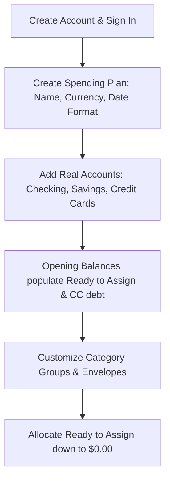
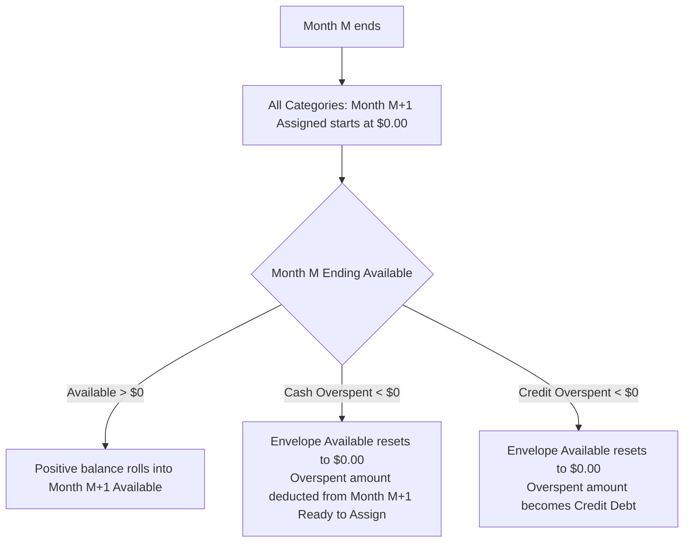

# docs/BEHAVIOR.md — User Interaction & Behavioral Specification

This document details how an end user experiences and interacts with **YNABx**. It serves as the canonical behavioral specification for designers, frontend engineers, backend developers, and AI agents building and extending user-facing features.

**How to read the tags used in this document**

| Tag | Meaning |
|---|---|
| **[YNAB]** | Behavior stated in the official YNAB Help Docs (link given at the top of each section). |
| **[Observed]** | Behavior or wording observed in the live YNAB web client but not stated in the Help Docs. Treat as best-effort and re-verify against real YNAB before relying on it. |
| **[YNABx]** | A deliberate YNABx decision or deviation from YNAB. |

---

## 1. Core Philosophy & Mental Model

> **Official YNAB Reference**: [The Four Rules of YNAB](https://www.ynab.com/the-four-rules)

YNABx is built on **Zero-Based Envelope Budgeting** and the **Four Rules of YNAB**:

1. **Rule 1: Give Every Dollar a Job**: When money enters the user's possession, they allocate every single cent into purposeful category envelopes until **Ready to Assign** equals exactly `$0.00`. The user never plans with money they don't yet have in the bank.
2. **Rule 2: Embrace Your True Expenses**: Large, irregular expenses (car insurance, holiday gifts, annual subscriptions) are broken down into predictable monthly savings targets.
3. **Rule 3: Roll With the Punches**: When life happens and a category is overspent, the user addresses it immediately by reallocating money from another envelope. Overspending is treated as a trade-off, not a failure.
4. **Rule 4: Age Your Money**: By consistently spending less than earned, the user gradually builds a buffer until they spend money earned 30+ days ago (breaking the paycheck-to-paycheck cycle).

---

## 2. Onboarding & First-Time Setup (Day 1)



### 2.1 Creating a Spending Plan (`Plan`)
- The user creates their first Spending Plan by choosing a **Name** (e.g., *"Family Plan 2026"*), **Currency** (e.g., `USD`, `VND`, `EUR`), and **Date Format** (`YYYY-MM-DD`, `DD/MM/YYYY`).
- Currency settings control decimal precision and formatting symbols across the entire UI.

### 2.2 Adding Accounts
The user links or manually adds their real-world financial accounts:
- **Checking / Savings / Cash (On-Plan Accounts)**:
  - The user enters the current actual bank balance as the **Opening Balance**.
  - Positive opening balances from on-plan cash accounts immediately flow into **Ready to Assign** at the top of the plan.
- **Credit Cards**:
  - The user enters their current outstanding credit card balance (e.g., `-$450.00`).
  - YNABx automatically creates a paired **Credit Card Payment** category in the budget grid.
  - *User Choice*: The user can choose to fund this pre-existing debt immediately by assigning cash to the Credit Card Payment category, or pay it off over time.

---

## 3. The Spending Plan Grid (The Heart of YNABx)

> **Official YNAB References**:
> - [Progress Bars: A Guide](https://support.ynab.com/en_us/progress-bars-a-guide-SkDEhot09)
> - [Colors and Icons in Your Plan](https://support.ynab.com/en_us/colors-and-icons-in-your-plan-HJQv_XHko)
> - [The Plan Header](https://support.ynab.com/en_us/the-plan-header-BkmiuJ_C9)
> - [How to Use Targets](https://support.ynab.com/en_us/how-to-use-targets-rk5kkI9ks)
> - [Underfunded: A Guide](https://support.ynab.com/en_us/underfunded-a-guide-BJwPhQO09)
> - [Snooze a Target](https://support.ynab.com/en_us/snooze-a-target-HyS4E5rZT)

The plan worksheet is an interactive monthly grid with three core columns per category:

> **Core Envelope Formula**:
> `Available = Prior Month Rollover + Assigned + Activity`

```
+-----------------------------------------------------------------------------------------+
|  [OCTOBER 2026]           ALL MONEY ASSIGNED: $0.00                                     |
+-----------------------------------------------------------------------------------------+
| Category Name                   |    Assigned    |    Activity    |    Available        |
+-----------------------------------------------------------------------------------------+
| ▼ Immediate Obligations         |                |                |                     |
|   ├─ Rent / Mortgage            |   $1,200.00    |   -$1,200.00   |        $0.00 (Gray) |
|   ├─ Groceries *                |     $450.00    |     -$125.40   |      $324.60 (Green)|
|   └─ Electric & Water           |     $110.00    |       -$0.00   |      $110.00 (Green)|
| ▼ True Expenses                 |                |                |                     |
|   ├─ Auto Insurance             |      $85.00    |       -$0.00   |      $255.00 (Green)|
|   └─ Medical Out-of-Pocket      |      $50.00    |       -$0.00   |      $150.00 (Green)|
| ▼ Credit Card Payments          |                |                |                     |
|   └─ Chase Sapphire Visa        |       $0.00    |     +$125.40   |      $125.40 (Green)|
+-----------------------------------------------------------------------------------------+
* The $125.40 grocery spending was made on the Chase Sapphire Visa, so the same amount
  moved into that card's Credit Card Payment category. Auto Insurance and Medical show
  rollover from prior months in Available ($170.00 and $100.00 respectively).
```

### 3.1 The "Ready to Assign" Banner (RTA)

**[YNAB]** Ready to Assign is money in cash-based accounts (like Checking) that has not been assigned to spending categories. On the web app the banner at the top of the plan has three states:

- **Green banner, `> $0.00`**: "Ready to Assign". Money is waiting to be assigned. The banner shows the amount and an **Assign Money** button.
- **Gray banner, `$0.00`**: "All Money Assigned". Every dollar has a job.
- **Red banner, `< $0.00`**: "You assigned more than you have". The user has assigned more than exists in their cash accounts. The banner shows the over-assigned amount as a negative number and a red **Fix This** button. The user must reduce assigned amounts until RTA reaches `$0.00`.

On mobile, the RTA banner appears only when funds are available to assign, and an *Over assigned* alert appears instead when RTA is negative.

### 3.2 Budget Cell Editing & Inline Calculator
- Clicking any cell in the **Assigned** column transforms it into an inline input.
- **Keyboard Navigation**: Pressing `Enter` saves, `Escape` cancels, and `Tab` moves to the next category cell.
- **Inline Calculator Expressions**: Users can type math expressions directly into the cell:
  - Typing `200 + 45.50` and pressing Enter sets the value to `$245.50`.
  - Typing `+50` adds `$50.00` to the current assigned balance.
  - Typing `-20` subtracts `$20.00` from the current assigned balance.
  - *Precision guarantee*: Expressions are evaluated and converted into integer milliunits without rounding drift.

### 3.3 Visual Status Colors (Category Balances)

**[YNAB]** Colors of the **Available** amount (see *Colors and Icons in Your Plan*):

| Color | Status Meaning | User Guidance |
|---|---|---|
| **Green** | **Funded & Ready** | Available is positive and enough to cover upcoming scheduled transactions. If the category has a target, the user is on track or has snoozed it. A savings target **without a due date** shows green whenever the category has any money, even if nothing was contributed this month. |
| **Gray** | **Zero & Not Underfunded** | `Available == $0.00` AND the category is not underfunded (it has no target or upcoming scheduled transactions, or its target was met and fully spent down to `$0.00`). |
| **Yellow** | **Underfunded / Credit Overspent** | Category is **underfunded**: the target is not met, or there is not enough for an upcoming **scheduled transaction** this month (even if `Available == $0.00`). Yellow is also used for **credit card overspending**. The icon tells which case applies. |
| **Red** | **Cash Overspent** | Immediate hazard! Money was spent from a cash/checking account that was not assigned. Some dollars spent are still sitting in other categories. Must be covered immediately. |

### 3.4 Category Progress Bars & Status Labels (Target Engine)

> **Frontend Styling Reference**: All CSS class names, SVG icon identifiers, and hex color tokens for progress bars and pills are specified in [docs/DESIGN.md §3.3](DESIGN.md#33-cấu-trúc-cell-danh-mục--thanh-tiến-độ-category-progress-bar). This section separates **Documented YNAB Behavior** (from official Help Docs) from **Observed Web UI / YNABx Adaptations**.

YNABx displays an optional toggleable progress bar (`showProgressBars` toggle in the plan toolbar) and contextual status text below each category name:

```
+-----------------------------------------------------------------------------+
| Groceries                  Funded. Spent $125.40 of $450.00    $324.60      |
| [╱╱╱╱╱╱╱╱╱╱╱█████████████████████████████]                                  |
+-----------------------------------------------------------------------------+
  ╱ = light/striped (spent)   █ = solid (still available)   blank = unfunded
```

#### A. Documented YNAB Behavior (Official Help Docs)

1. **Optional Visibility Toggle**: Progress bars can be toggled on or off in the plan view options. YNABx supports this toggle in the budget toolbar.
2. **Multi-Section Bar Structure**:
   - **One section** represents the **month** for categories with no target, a snoozed target, a monthly "Refill up to..." target, or a monthly "Set aside another..." target whose Available balance was zero at the end of the prior month. For targets with a yearly (or less frequent) cadence, one section represents the **target period**.
   - **Two sections** appear for a **"Set aside another..."** target when money rolled over from the previous period, for both cadences:
     - *Monthly*: first section = funds rolled over from the previous month; second = money assigned in the current month.
     - *Yearly or less frequent*: first section = funds rolled over from the previous target period; second = money assigned in the current target period.
   - **Weekly targets (`WEEKLY`)**:
     - With **"Refill up to..."**: one section per week in the current month (**4 or 5 sections**, e.g., 5 Sundays in a 31-day month).
     - With **"Set aside another..."**: the first section is the month (if nothing rolled over) or the funds rolled over from the previous period, followed by one section per week, so the bar can have **up to 6 sections**.
   - **Extra section**: A category with a weekly target gets an extra section appended at the right when **more was assigned or spent than the target amount** (example: $100/week target, $0 start, $500 spent in a 4-week month gives 5 sections, the last one red). **The extra section remains after the user has covered the overspending**, to show the extra assigned amount.
   - **Rollover timing for "Refill up to..."**: Leftover funds rolled over from the previous month do **not** count toward the new month's target progress until the new month actually starts. Leftover from previous months does not show as progress.
   - **Assigning into the future**: The bar always shows progress for the month being viewed.
3. **Bar Colors**:
   - **Green**: the target is fully funded for the month, the target is snoozed, or money is available in a category without a target. Light green = money spent, dark green = money still available.
   - **Yellow**: money was assigned but the target is not met. Light yellow = spent, dark yellow = still available.
   - **Gray / empty**: the category has not been funded and nothing was spent this month.
   - **Red**: spending exceeds the Available amount. The bar is entirely red if nothing was assigned, otherwise the red part is the amount overspent. **Overspending is always red in the bar**, whether it is cash or credit. The Available pill and icon tell the two apart.
4. **Dual-Tone Shading Within Sections**:
   - **Light / Striped Shade (Spent Portion)**: money already spent (`Activity`).
   - **Solid Dark Shade (Available Portion)**: money remaining to spend (`Available`).
   - **Empty Track**: the remaining unfunded portion (`Needed`) required to meet the target.
5. **Spending order**: Money rolled over from the previous month is always spent first. There is no way to choose which section to spend from.

#### B. Category Status Table (Documented vs. Observed)

Pill colors and icons come from *Colors and Icons in Your Plan*. Bar colors come from *Progress Bars: A Guide*. The inline status wording (`Funded. Spent $X of $Y`, `$X more needed this month`, and so on) is **[Observed]** from the live YNAB web client and is used as-is in YNABx. Cells marked *(Observed)* are not stated in the Help Docs.

| State | Condition | Bar & Available Pill Color | Available Icon | Status Text (Observed, used in YNABx) |
|---|---|---|---|---|
| **Funded (Unspent)** | Target met (`needed == 0`), or no-due-date target with `Available > 0`, or no target with `Available > 0`; `Spent == 0` | **Green** bar (100% solid) + **Green** pill | **Checkmark circle** if a target exists and is met (plain green circle if on track but not yet met) | **`Funded`** |
| **Funded (Partially Spent)** | Target met (or no target), `Available > 0`, `Spent > 0` | **Green** bar (light/striped spent + solid available) + **Green** pill | **Checkmark circle** if a target exists | **`Funded`**`. Spent $X of $Y` |
| **Fully Spent** | Not underfunded (`needed == 0` or no target), `Available == $0.00`, `Spent > 0` | **Green** bar (100% light/striped spent) + **Gray** pill | **Checkmark circle** if a target exists | **`Fully Spent`**`. Spent $X of $X` |
| **Underfunded Target (Unfunded)** | Target `needed > 0`, `Assigned == 0`, `Available == $0.00`, `Spent == 0` | **Empty** track (0% fill) + **Yellow** pill (any underfunded category is yellow, even at `$0.00`) | **Pie chart** (empty progress circle) | **`$X`**` needed this month` |
| **Underfunded Target (Partially Funded)** | Target `needed > 0`, and `Assigned > 0` or `Available > 0` or `Spent > 0` | **Yellow** bar (light/striped spent + solid available + empty track) + **Yellow** pill | **Pie chart** (partly filled) | **`$X`**` more needed this month` |
| **Underfunded Scheduled Transaction** | `Available` is insufficient for upcoming scheduled transaction(s) this month | Pill: **Yellow**. Bar color: *(Observed)* yellow | **Calendar** | **`$X`**` needed for scheduled transactions` *(Observed)* |
| **Snoozed Target** | Target snoozed for the month, no unfunded scheduled transaction | Bar: **Green** if funded, otherwise **Empty** track. Pill: **Green** if `Available > 0`, **Gray** if `Available == $0.00` | **Snooze (`Zz`)** | **`Snoozed`** |
| **Snoozed Target + Unfunded Scheduled Tx** | Target snoozed, but a scheduled transaction this month still needs funding | Pill: **Yellow** (documented: snooze icon with a yellow amount means a scheduled transaction needs funding). Bar color: *(Observed)* yellow | **Snooze (`Zz`)** | **`Snoozed`** *(Observed)* |
| **Cash Overspent** | `Available < $0.00` from a cash/checking account | Funded portion (if any) + **Red** overspent segment. Pill: **Red** | *(No icon)* | **`Overspent`**`. $Spent of $Funded` |
| **Credit Overspent** | `Available < $0.00` from a credit card | Funded portion (if any) + **Red** overspent segment. Pill: **Yellow** | **Credit card with `!`** | **`Overspent`**`. $Spent of $Funded` |
| **Untouched / Empty** | No target, no scheduled tx, `Assigned == 0`, `Spent == 0`, `Available == $0.00` | **Empty** track + **Gray** pill (`$0.00`) | *(No icon)* | *(Blank, no status text)* |

**Icon notes [YNAB]**: pie chart = not enough assigned for the target yet. Plain green circle = on track. Green circle with checkmark = target met. `Zz` = target snoozed (the user is not asked to assign more for it this month). Calendar = not enough money for a scheduled transaction later in the month. Credit card with `!` = credit overspending (if not covered it becomes debt to pay by assigning to the Credit Card Payment category in a future month).

---

## 4. Account Register & Transaction Tracking (Daily Life)

> **Official YNAB References**:
> - [Approving and Matching Transactions: A Guide](https://support.ynab.com/en_us/approving-and-matching-transactions-a-guide-ByYNZaQ1i)
> - [Pending Transactions: An Overview](https://support.ynab.com/en_us/pending-transactions-an-overview-Bk0WoOcA5)
> - [Scheduled Transactions: A Guide](https://support.ynab.com/en_us/scheduled-transactions-a-guide-BygrAIFA9)
> - [Flags: A Guide](https://support.ynab.com/en_us/flags-a-guide-Skh8Xb4kj)
> - [Split Transactions: A Guide](https://support.ynab.com/en_us/split-transactions-a-guide-SJLEKwY0q)
> - [Transfer Transactions: A Guide](https://support.ynab.com/en_us/transfer-transactions-a-guide-HJOsZz4Jj)

The account register displays transactional ledgers for individual accounts or an aggregated "All Accounts" view.

### 4.1 Recording Daily Transactions
When recording an expenditure via the inline **Add Transaction** row (`.ynab-grid-add-rows > .ynab-grid-body-row.is-editing.is-checked.is-adding`):
- **Row Elements & Controls**:
  - **Checkbox**: Checked selection state (`ynab-checkbox ynab-checkbox-button is-checked`) with `#icon_sprite_check`.
  - **Notification**: Empty notification slot matching the register grid column layout.
  - **Flag**: Flag button (`ynab-flag-pill ynab-flag-pill-none ynab-flag-icon-only`) with `#icon_sprite_flag`.
  - **Account Selector** (All Accounts view): Dropdown field (`accounts-text-field dropdown-text-field ember-text-field`) with `#icon_sprite_caret_down`.
1. **Date**: Defaults to today. Clicking the date cell opens the **Transaction Date Picker Popover** (`modal-account-calendar`), featuring calendar month navigation (`chevron_left_circle`, `chevron_right_circle`), weekday headers (`Su`–`Sa`), day grid, and recurrence options (`Repeat: Never`, `Daily`, `Weekly`, `Every other week`, `Monthly`, etc.).
2. **Payee**: Autocompletes through the **Payee Combobox Popover** (`modal-account-payees`), categorizing options into:
   - **Payments and Transfers**: Lists eligible non-closed user accounts (`To/From [Account Name]`). Selecting an on-budget transfer automatically disables the category field.
   - **Saved Payees**: Filters existing payees dynamically as the user types.
   - **Add New Payee**: Allows instant 1-click addition if the typed payee does not match an existing record.
   - **Manage Payees**: Quick link at the footer of the dropdown.
3. **Category**: Selected via the **Category Combobox Popover** (`modal-account-categories`):
   - Categorized by groups (e.g., `Inflow: Ready to Assign`, `Bills`, `Variable Expenses`, etc.).
   - Displays real-time category envelope available balance pills (`positive`, `negative`, or `zero`).
   - Includes quick-action buttons for **New Category**, **Payment/Transfer**, and **Split**.
4. **Memo**: Optional notes or tags.
5. **Outflow / Inflow**: Entered via currency inputs (`ynab-new-currency-input is-editing`) featuring an inline calculator button (`button-calculator` with `<svg class="icon-calculator">`) and `.input-wrapper`. Converted to integer milliunits.
6. **Cleared Status**: Toggled between **Uncleared** (`ynab-cleared is-uncleared` with `#icon_sprite_cleared_circle`) and **Cleared** (`ynab-cleared is-cleared` with `#icon_sprite_cleared_circle_fill`).
7. **Actions Bar**: Dedicated bottom actions panel (`.ynab-grid-actions.is-add-row > .buttons-container > .ynab-grid-actions-buttons`) containing **Cancel** (`button button-cancel`), **Save and add another** (`button button-secondary`), and **Save** (`button button-primary`).
8. **Keyboard Navigation**: Pressing `Enter` in any field saves the transaction, `Shift + Enter` saves and adds another transaction keeping the row open with the date preserved, while `Escape` cancels editing and dismisses the add row.

### 4.2 Recording Income
- When a salary or income transaction is recorded, the category is set to the system category: **`Inflow: Ready to Assign`**.
- The amount immediately increases the top **Ready to Assign** banner in the Spending Plan.

### 4.3 Split Transactions (Multi-Category Receipts)
- When a single receipt covers multiple purposes (e.g., Walmart receipt with `$60` Groceries and `$25` Home Supplies):
  - User clicks **Split Transaction**.
  - Adds subtransaction lines specifying category, amount, and optional memo.
  - YNABx enforces that the sum of subtransaction amounts matches the parent transaction total exactly down to the last milliunit.
- **[YNAB]** A split transaction cannot be matched to multiple imported transactions. If a single purchase is later imported as several separate charges, delete the manual transaction and let the imports come in individually.

### 4.4 Account Transfers (Moving Money Between Accounts)
- Transfers between user accounts (e.g., Checking → Savings, or Checking → Credit Card) use the Payee: **`To/From: [Account Name]`**.
- Transfers between on-plan accounts **do not require a spending category** because the total cash in the spending plan has not changed, only the storage container changed.
- YNABx generates a paired transaction in the destination account with the inverse amount (`+X` and `-X`).

### 4.5 Cleared, Uncleared, and Reconciled Lifecycle (vs. Bank Pending)
Every register transaction has a `cleared` status representing its real-world bank settlement:

```
 UNCLEARED (○) ──bank posts it──▶ CLEARED (C) ──Reconcile──▶ RECONCILED (🔒)
   user-entered or scheduled         settled at bank              verified against statement
```

| Cleared State | Icon | Behavioral Meaning |
|---|---|---|
| **`UNCLEARED`** | Hollow gray circle (`○`) | **User-Entered / Unsettled in Bank**: Transaction is recorded in the register and **immediately** counts toward `Uncleared Balance`, `Working Balance`, and the category's `Activity`/`Available`, but has not yet posted at the bank. |
| **`CLEARED`** | Green circle with `C` (`✓`) | **Settled / Posted**: Transaction has posted at the bank and appears on official banking records. |
| **`RECONCILED`** | Green padlock icon (`🔒`) | **Verified**: Transaction was matched against the bank during Account Reconciliation.<br/>• **[YNAB]** Once reconciled, a transaction stays reconciled. YNAB provides no way to reverse this and the lock icon remains.<br/>• **[YNABx] Deviation**: YNABx enforces ledger immutability on `RECONCILED` rows (date, payee, category, amount, and account are locked) until the user explicitly clicks **Unlock** on that row. There is no batch undo of a reconciliation. |

> [!IMPORTANT]
> **`UNCLEARED` is NOT "Bank Pending"**:
> - In YNAB, **`UNCLEARED`** is a state on normal register transactions that you manage. It immediately impacts your Spending Plan (`Available`) and `Working Balance`.
> - **Bank Pending Transactions** (in official YNAB) are bank-reported authorization holds shown in a separate collapsible *"Pending Transactions"* section at the top of the register. They do **not** affect the Spending Plan or any balance (even the uncleared balance) until the user chooses *"Enter Now"* or edits the row, which moves it into the register, or until the cleared transaction imports from the bank.
> - **YNABx Support Status**: **Bank Pending Transactions are currently not supported in YNABx.** All transactions saved or imported into YNABx enter the main register directly (as `UNCLEARED` or `CLEARED`) and affect the Spending Plan immediately.

#### Register Header Balances
The register header breaks down account balances into 3 figures:
1. **Cleared Balance**: Sum of all `CLEARED` and `RECONCILED` transactions. Must match the user's settled bank balance.
2. **Uncleared Balance**: Sum of all `UNCLEARED` register transactions.
3. **Working Balance**: `Cleared Balance + Uncleared Balance`. Represents the actual financial reality available for the spending plan.

### 4.6 Transaction Approval & Matching Workflow (`approved`)

When transactions enter YNABx via **File Import (OFX/QFX/CSV)**, direct bank synchronization, or **Scheduled Transactions** reaching their due date, they enter an unapproved state (`approved = false`) and wait for the user's review:

- **Review Flag Only (Zero Calculation Impact)**: **`approved` is strictly a user review flag and does NOT affect account balances (`Cleared`, `Uncleared`, `Working`), category `Activity`, or `Available`.** Unapproved transactions in the register already count toward the Spending Plan from the moment they are created or imported. **[YNAB]** The only exception is bank-pending transactions, which are not reflected until they clear.
- **Orthogonality of `approved` and `cleared`**: `approved` (`true` | `false`) and `cleared` (`UNCLEARED` | `CLEARED` | `RECONCILED`) are **two completely independent flags** that can occur in any combination (e.g., an imported bank transaction is typically `CLEARED` + `approved = false`; a manually entered purchase starts as `UNCLEARED` + `approved = true`).
- **Scheduled Transactions [YNAB]**:
  - A scheduled transaction sits in a collapsible **Scheduled** section and **does not affect the plan until its due date** (the plan still shows a yellow alert when `Available` is not enough to cover it).
  - When created, it is marked **`UNCLEARED`**. **Exception: scheduled transactions in cash accounts are marked `CLEARED`.**
  - On the due date it appears in the register (in bold). If the same transaction imports from the bank it is **automatically matched and approved**. Otherwise the user must **approve it manually** to confirm it happened as planned.
- **Transaction Matching [YNAB]**:
  - **Auto-matching**: When an imported bank transaction has the **exact same amount** as an existing manually entered (or scheduled) transaction in the same account and the dates are **within 10 days** of each other, the two are linked into one **matched transaction** (shown with a link icon). **Matched transactions are automatically approved**, with no separate approval step.
  - **Field precedence**: The bank's **amount** is kept (it is treated as authoritative), along with the **payee, memo, and date the user entered**.
  - **Manual match**: When auto-matching does not apply (dates more than 10 days apart, or amounts that do not line up exactly, common with variable recurring bills), the user can select two transactions in the **same account register** and click **Match**, as long as neither is already matched to another transaction. The bank's amount is still kept.
  - **One-to-one and Unmatch**: Matching is strictly one-to-one and can be reversed with **Unmatch**.
  - **Rejecting and deleting imports**: A transaction can be **rejected** only before it is approved (after approval the same action is called delete). Once an imported transaction is rejected or deleted, it **will not be imported again**.
  - **Transfers**: Approving a transfer in one account register automatically approves the paired transaction in the other account.
- **Register Notice & Sidebar Account Indicator**:
  - Unapproved rows are highlighted in the register with an informational icon (circled `i`) so the user can verify the payee, confirm or change the category, and click **Approve** (single or bulk). The icon disappears once approved.
  - On the web app, a blue banner "N new transactions to approve or categorize" filters the register to unapproved/uncategorized transactions.
  - When an account has one or more unapproved transactions, a **white notification dot (or badge count)** appears next to that account's name in the left sidebar. There is no equivalent notification for bank-pending transactions.

### 4.7 Color Flags (`flag_color`)
Each transaction can carry an optional color flag:
- Available colors: `RED`, `ORANGE`, `YELLOW`, `GREEN`, `BLUE`, `PURPLE` (or `null`).
- User-defined taxonomy for operational tagging (e.g., *Blue* = business expenses for reimbursement, *Yellow* = purchases needing partner discussion, *Purple* = tax-deductible items).
- The register toolbar enables instant 1-click filtering by flag color.

---

## 5. Credit Card Mechanics (Automatic Debt Prevention)

> **Official YNAB References**:
> - [Handling Credit Cards in YNAB: An Overview](https://support.ynab.com/en_us/handling-credit-cards-overview-ry7cNub1s)
> - [Credit Card Overspending: An Overview](https://support.ynab.com/en_us/credit-card-overspending-an-overview-HkMGpSbJs)

YNABx treats credit cards as payment conduits rather than debt instruments.

### 5.1 Funded Credit Card Spending (The "Magic" Shift)
1. User has `$100.00` Available in **Groceries**.
2. User buys `$40.00` of groceries using their **Chase Visa** credit card.
3. User logs the transaction: Account = *Chase Visa*, Category = *Groceries*, Outflow = `$40.00`.
4. **What YNABx does automatically**:
   - **Groceries Available** decreases from `$100.00` to `$60.00`.
   - **Chase Visa Payment Available** automatically increases from `$0.00` to **`+$40.00`** (Green).
5. **End-user result**: The `$40.00` cash that was reserved for groceries is now reserved to pay the credit card bill. The user has created zero new debt.

### 5.2 Credit Overspending (Unfunded Purchases)
- If the user spends `$60.00` at a restaurant using a credit card, but only had `$40.00` available in **Dining Out**:
  - **Dining Out Available** drops to `-$20.00` (highlighted in **Yellow** with a credit card icon; the progress bar shows the overspent part in red).
  - Only `$40.00` of cash moves to the Credit Card Payment category.
  - The `$20.00` difference becomes unbudgeted debt on the card.
- Adding money to a category with credit overspending flows automatically into that card's Credit Card Payment category.

### 5.3 Paying the Credit Card Bill
- When the monthly credit card bill arrives, the user pays the amount shown in the green **Credit Card Payment Available** envelope.
- Recorded as a transfer from Checking → Credit Card Account.
- Both the bank checking balance and the credit card debt decrease together, and the Payment envelope resets to `$0.00`.

---

## 6. Month-to-Month Rollover Behavior

> **Official YNAB Reference**: [When the Month Rolls Over: A Guide](https://support.ynab.com/en_us/when-the-month-rolls-over-a-guide-rkyyd6qC9)

When the calendar shifts from Month `M` to Month `M+1`:



1. **`Assigned` Resets to `$0.00`**:
   - In the new month `M+1`, every category's **`Assigned` column resets to `$0.00`** (unless the user had previously flipped ahead to Month `M+1` and assigned money in advance).
2. **Positive Available Rollover**:
   - If *Auto Insurance* had `$255.00` available on October 31, it starts November 1 with `$255.00` starting `Available` balance (even with November `Assigned == $0.00`).
3. **Cash Overspending Rollover**:
   - If *Groceries* was cash overspent by `-$30.00` in October, November 1 resets Groceries `Available` to `$0.00` (gray) and **deducts `$30.00` from November's Ready to Assign**. The user must pay back their cash buffer before assigning new income.
4. **Credit Overspending Rollover**:
   - If *Dining Out* was credit overspent by `-$20.00` in October, November 1 resets Dining Out `Available` to `$0.00`. November's Ready to Assign is **not deducted**. The `$20.00` remains unpaid credit card debt and the Credit Card Payment category is alerted as underfunded. If the user wants to pay it off, they budget directly into the *Credit Card Payment* envelope in November.
5. **Leftover Ready to Assign**:
   - With no cash overspending, the remaining Ready to Assign rolls over to the new month. With cash overspending, that amount is removed from the leftover.
6. **Budgeting in Future Months**:
   - Users can click ahead to Month `M+1` anytime to assign surplus money into future envelopes. Money assigned in the future is deducted from the current month's Ready to Assign.

---

## 7. "Roll With the Punches" (Covering Overspending)

> **Official YNAB Reference**: [Moving Money in Your Plan: A Guide](https://support.ynab.com/en_us/moving-money-in-your-plan-ryyCKbBJi)

When an envelope goes into the red (cash overspending) or shows yellow with a credit card icon (credit overspending):
1. The user clicks on the overspent category's Available amount.
2. A **"Cover Overspending With..."** popover appears.
3. The user selects any category that has surplus funds (e.g., *"Dining Out"* or *"Vacation Fund"*).
4. YNABx atomically transfers the needed amount between envelopes, bringing the overspent category back to `$0.00` (Gray) and keeping the plan balanced.

---

## 8. Bank Reconciliation Workflow

> **Official YNAB References**:
> - [Reconciling Accounts: A Guide](https://support.ynab.com/en_us/reconciling-accounts-a-guide-BJFE3fHys)
> - [Balance Adjustments](https://support.ynab.com/en_us/balance-adjustments-a-guide-rko4OwILs)

To ensure the spending plan matches reality:
1. User clicks **Reconcile Account** in the account header. Before that, the user should import or enter recent bank transactions, mark the ones that cleared at the bank as `CLEARED`, and leave bank-pending items `UNCLEARED`.
2. App asks: *"Is your current bank balance $1,425.50?"* (comparing against the account's `Cleared Balance`; the bank figure to use is the current balance without pending transactions).
3. **If Yes**:
   - All `CLEARED` transactions are marked as **`RECONCILED`** (leaving `UNCLEARED` transactions untouched).
   - **No batch undo**: **[YNAB]** reconciled status cannot be reversed. In YNABx an individual row can be unlocked as described in §4.5 (a deliberate deviation), but a reconciliation as a whole is never rolled back.
   - **3-Day Import Lookback Filter [YNAB]**: After an account is reconciled, imports only bring in transactions dated **no earlier than 3 days before the most recent `RECONCILED` transaction**, which prevents duplicate historical imports.
4. **If No**:
   - User enters the actual statement balance from their banking app.
   - App displays the discrepancy difference (`statement_balance - cleared_balance`).
   - User reviews uncleared transactions to mark newly posted items as `CLEARED` or add missing transactions.
   - If an unexplained discrepancy remains and the user chooses **Create Reconciliation Adjustment**:
     - For **on-plan Cash / Checking / Savings accounts**, YNABx creates a cleared adjustment transaction categorized to **`Inflow: Ready to Assign`** (positive or negative `diff`), so `Ready to Assign` directly reflects the cash adjustment. **[YNAB]** The adjustment amount is added to or deducted from Ready to Assign.
     - For **Credit Card or Tracking accounts**, YNABx creates a cleared adjustment transaction with no category (`category_id = null`), adjusting the card debt or tracking balance directly. **[YNAB]** The plan is not affected, but the user should check that the card's Credit Card Payment category holds the intended amount.
   - A **reconciliation** adjustment changes the **cleared** balance. A manual balance adjustment from account details changes the working balance instead and is not recommended by YNAB.
5. **Frequency [YNAB]**: YNAB recommends reconciling spending accounts at least once a week.
