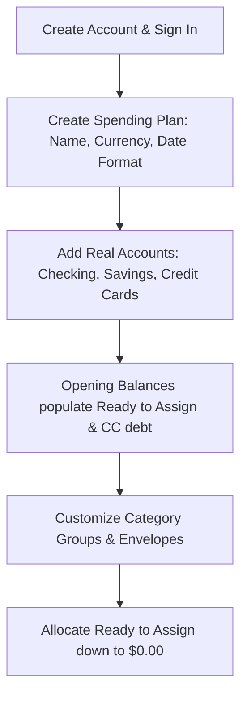
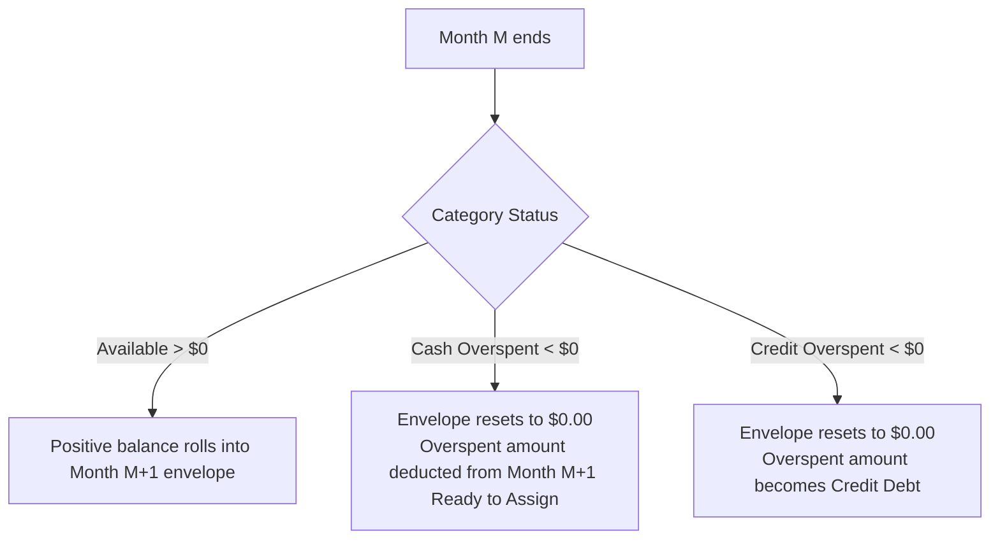

# docs/BEHAVIOR.md — User Interaction & Behavioral Specification

This document details how an end user experiences and interacts with **YNABx**. It serves as the canonical behavioral specification for designers, frontend engineers, backend developers, and AI agents building and extending user-facing features.

---

## 1. Core Philosophy & Mental Model

YNABx is built on **Zero-Based Envelope Budgeting** and the **Four Rules of YNAB**:

1. **Rule 1: Give Every Dollar a Job**: When money enters the user's possession, they allocate every single cent into purposeful category envelopes until **Ready to Assign** equals exactly `$0.00`. The user never plans with money they don't yet have in the bank.
2. **Rule 2: Embrace Your True Expenses**: Large, irregular expenses (car insurance, holiday gifts, annual subscriptions) are broken down into predictable monthly savings targets.
3. **Rule 3: Roll With the Punches**: When life happens and a category is overspent, the user addresses it immediately by reallocating money from another envelope. Overspending is treated as a trade-off, not a failure.
4. **Rule 4: Age Your Money**: By consistently spending less than earned, the user gradually builds a buffer until they spend money earned 30+ days ago (breaking the paycheck-to-paycheck cycle).

---

## 2. Onboarding & First-Time Setup (Day 1)



### 2.1 Creating a Spending Plan (`Plan`)
- The user creates their first Spending Plan by choosing a **Name** (e.g., *"Family Plan 2026"*), **Currency** (e.g., `USD`, `VND`, `EUR`), and **Date Format** (`YYYY-MM-DD`, `DD/MM/YYYY`).
- Currency settings control decimal precision and formatting symbols across the entire UI.

### 2.2 Adding Accounts
The user links or manually adds their real-world financial accounts:
- **Checking / Savings / Cash (On-Plan Accounts)**:
  - The user enters the current actual bank balance as the **Opening Balance**.
  - Positive opening balances from on-plan cash accounts immediately flow into **Ready to Assign** at the top of the plan.
- **Credit Cards**:
  - The user enters their current outstanding credit card balance (e.g., `-$450.00`).
  - YNABx automatically creates a paired **Credit Card Payment** category in the budget grid.
  - *User Choice*: The user can choose to fund this pre-existing debt immediately by assigning cash to the Credit Card Payment category, or pay it off over time.

---

## 3. The Spending Plan Grid (The Heart of YNABx)

The plan worksheet is an interactive monthly grid with three core columns per category:

$$\text{Available} = \text{Prior Month Rollover} + \text{Assigned} + \text{Activity}$$

```
+-----------------------------------------------------------------------------------------+
|  [OCTOBER 2026]           READY TO ASSIGN: $0.00  (All money has a job!)                |
+-----------------------------------------------------------------------------------------+
| Category Name                   |    Assigned    |    Activity    |    Available        |
+-----------------------------------------------------------------------------------------+
| ▼ Immediate Obligations         |                |                |                     |
|   ├─ Rent / Mortgage            |   $1,200.00    |   -$1,200.00   |        $0.00 (Gray) |
|   ├─ Groceries                  |     $450.00    |     -$125.40   |      $324.60 (Green)|
|   └─ Electric & Water           |     $110.00    |       -$0.00   |      $110.00 (Green)|
| ▼ True Expenses                 |                |                |                     |
|   ├─ Auto Insurance             |      $85.00    |       -$0.00   |      $255.00 (Green)|
|   └─ Medical Out-of-Pocket      |      $50.00    |       -$0.00   |      $150.00 (Green)|
| ▼ Credit Card Payments          |                |                |                     |
|   └─ Chase Sapphire Visa        |       $0.00    |     +$125.40   |      $125.40 (Green)|
+-----------------------------------------------------------------------------------------+
```

### 3.1 The "Ready to Assign" Banner
- **Green (`$0.00`)**: Perfection. Every dollar has been assigned a job.
- **Green (`> $0.00`)**: Money waiting to be assigned. The user is prompted to assign it to bills, goals, or savings.
- **Red (`< $0.00`)**: Over-assigned! The user has allocated more money than actually exists in their bank accounts. The user must reduce assigned amounts in envelopes until RTA reaches `$0.00`.

### 3.2 Budget Cell Editing & Inline Calculator
- Clicking any cell in the **Assigned** column transforms it into an inline input.
- **Keyboard Navigation**: Pressing `Enter` saves, `Escape` cancels, and `Tab` moves to the next category cell.
- **Inline Calculator Expressions**: Users can type math expressions directly into the cell:
  - Typing `200 + 45.50` and pressing Enter sets the value to `$245.50`.
  - Typing `+50` adds `$50.00` to the current assigned balance.
  - Typing `-20` subtracts `$20.00` from the current assigned balance.
  - *Precision guarantee*: Expressions are evaluated and converted into integer milliunits without rounding drift.

### 3.3 Visual Status Colors (Category Balances)

| Color | Status Meaning | User Guidance |
|---|---|---|
| **Green** | **Funded & Ready** | Money is in the bank waiting to be spent for this specific purpose. |
| **Gray** | **Spent Down to $0.00** | Category has fulfilled its purpose for this month. No funds remain. |
| **Yellow** | **Underfunded Goal / Credit Warning** | Target goal not yet met, or category has credit card debt that hasn't been budgeted for. |
| **Red** | **Cash Overspent** | Immediate hazard! The user spent physical cash/checking money that wasn't budgeted. Must be covered immediately. |

### 3.4 Category Progress Bars & Status Labels (Target Engine)

YNABx displays a dynamic progress bar and contextual status badge below each category name to visualize goal achievement and monthly envelope consumption:

```
+-----------------------------------------------------------------------------+
| Groceries                                                      $324.60      |
| [████████████████████░░░░░░░░░░░░░░░░░░░░]  Funded · Spent $125.40          |
+-----------------------------------------------------------------------------+
```

#### Multi-Segment Bar Structure
- **Monthly Targets (`MONTHLY`)**: Rendered as a single continuous progress bar spanning 0% to 100%.
- **Weekly Targets (`WEEKLY`)**: Segmented into 4 or 5 discrete blocks corresponding to the exact number of target weekdays occurring in the active calendar month (e.g., 5 Fridays in a 31-day month).
- **Rollover Savings (`SET_ASIDE_ANOTHER`)**: When positive funds roll over from the prior month, the bar renders 2 distinct segments: prior month savings foundation + current month new savings target.

#### Dual-Tone Shading Within Segments
Each segment renders up to 3 visual layers:
1. **Dark / Striped Shade (`spentRatio`)**: Fraction of the target already spent (`Activity`).
2. **Solid Medium Shade (`availableRatio`)**: Fraction of the target currently funded and available in the envelope (`Available`).
3. **Light / Empty Track (`emptyRatio`)**: Fraction remaining unfunded (`Needed`).

#### Category Status Labels & Badges
- **`Funded` / `Funded · Spent $X.XX`** (Green): Target is 100% satisfied. Displays spent amount if activity occurred.
- **`Need $X.XX more`** (Yellow pill with pie chart icon): Category is **Underfunded**; user needs to assign additional money this month.
- **`Snoozed`** (Green pill with `Zzz` snooze icon): Target has been paused for this specific calendar month. Excluded from "Underfunded" auto-assign calculations without deleting target settings.
- **`Overspent by $X.XX`** (Urgent Red pill): **Cash overspending** from cash/checking accounts. Requires immediate assignment to prevent budget corruption.
- **`Credit Card Overspent · $X.XX`** (Yellow pill with credit card warning icon): **Credit overspending** from card accounts. Signals that future card payment may fall short unless covered.
- **`Spent $X.XX of $Y.YY` / `All spent`** (Neutral Gray): Category without a target has consumed part or all of its allocated funds.

---

## 4. Account Register & Transaction Tracking (Daily Life)

The account register displays transactional ledgers for individual accounts or an aggregated "All Accounts" view.

### 4.1 Recording Daily Transactions
When recording an expenditure:
1. **Date**: Defaults to today.
2. **Payee**: Autocompletes existing payees or creates a new one (e.g., *"Trader Joe's"*).
3. **Category**: Selected from active category envelopes.
4. **Memo**: Optional notes or tags.
5. **Outflow / Inflow**: Entered in currency units and converted to integer milliunits.
6. **Cleared Status**: Toggled between **Uncleared** (pending charge) and **Cleared** (posted to bank).

### 4.2 Recording Income
- When a salary or income transaction is recorded, the category is set to the system category: **`Inflow: Ready to Assign`**.
- The amount immediately increases the top **Ready to Assign** banner in the Spending Plan.

### 4.3 Split Transactions (Multi-Category Receipts)
- When a single receipt covers multiple purposes (e.g., Walmart receipt with `$60` Groceries and `$25` Home Supplies):
  - User clicks **Split Transaction**.
  - Adds subtransaction lines specifying category, amount, and optional memo.
  - YNABx enforces that the sum of subtransaction amounts matches the parent transaction total exactly down to the last milliunit.

### 4.4 Account Transfers (Moving Money Between Accounts)
- Transfers between user accounts (e.g., Checking $\rightarrow$ Savings, or Checking $\rightarrow$ Credit Card) use the Payee: **`To/From: [Account Name]`**.
- Transfers between on-plan accounts **do not require a spending category** because the total cash in the spending plan has not changed—only the storage container changed.
- YNABx generates a paired transaction in the destination account with the inverse amount (`+X` and `-X`).

### 4.5 Cleared, Uncleared, and Reconciled Lifecycle
Every transaction has a cleared status representing its real-world bank settlement:

| Cleared State | Icon | Behavioral Meaning |
|---|---|---|
| **`UNCLEARED`** | Hollow gray circle (`○`) | **Pending transaction**: User spent money, but the transaction has not yet posted to the bank statement. |
| **`CLEARED`** | Green circle with `C` (`✓`) | **Settled / Posted**: Transaction has posted to the bank account and appears on official banking records. |
| **`RECONCILED`** | Green padlock icon (`🔒`) | **Locked**: Transaction was matched against an official bank statement during Account Reconciliation. Date, payee, category, amount, and account fields become immutable to prevent audit drift. |

#### Register Header Balances
The register header breaks down account balances into 3 figures:
1. **Cleared Balance**: Sum of all `CLEARED` and `RECONCILED` transactions. Must match the user's online bank statement.
2. **Uncleared Balance**: Sum of all pending `UNCLEARED` transactions.
3. **Working Balance**: `Cleared Balance + Uncleared Balance`. Represents the actual financial reality available for the spending plan.

### 4.6 Transaction Approval Workflow (`approved`)
When transactions enter YNABx automatically via **File Import (OFX/QFX/CSV)**, direct bank synchronization, or auto-generated **Scheduled Recurring Transactions**, they enter an unapproved state (`approved = false`):
- Highlighted with an informational notice pill ("Needs Approval").
- Allows the user to inspect payee matching, adjust categories, or split lines before committing.
- Single-click or bulk **Approve** marks them `approved = true` and updates category calculations.

### 4.7 Color Flags (`flag_color`)
Each transaction can carry an optional color flag:
- Available colors: `RED`, `ORANGE`, `YELLOW`, `GREEN`, `BLUE`, `PURPLE` (or `null`).
- User-defined taxonomy for operational tagging (e.g., *Blue* = business expenses for reimbursement, *Yellow* = purchases needing partner discussion, *Purple* = tax-deductible items).
- The register toolbar enables instant 1-click filtering by flag color.

---

## 5. Credit Card Mechanics (Automatic Debt Prevention)

YNABx treats credit cards as payment conduits rather than debt instruments.

### 5.1 Funded Credit Card Spending (The "Magic" Shift)
1. User has `$100.00` Available in **Groceries**.
2. User buys `$40.00` of groceries using their **Chase Visa** credit card.
3. User logs the transaction: Account = *Chase Visa*, Category = *Groceries*, Outflow = `$40.00`.
4. **What YNABx does automatically**:
   - **Groceries Available** decreases from `$100.00` to `$60.00`.
   - **Chase Visa Payment Available** automatically increases from `$0.00` to **`+$40.00`** (Green).
5. **End-user result**: The `$40.00` cash that was reserved for groceries is now reserved to pay the credit card bill. The user has created zero new debt.

### 5.2 Credit Overspending (Unfunded Purchases)
- If the user spends `$60.00` at a restaurant using a credit card, but only had `$40.00` available in **Dining Out**:
  - **Dining Out Available** drops to `-$20.00` (highlighted in **Yellow** with a credit card icon).
  - Only `$40.00` of cash moves to the Credit Card Payment category.
  - The `$20.00` difference becomes unbudgeted debt on the card.

### 5.3 Paying the Credit Card Bill
- When the monthly credit card bill arrives, the user pays the amount shown in the green **Credit Card Payment Available** envelope.
- Recorded as a transfer from Checking $\rightarrow$ Credit Card Account.
- Both the bank checking balance and the credit card debt decrease together, and the Payment envelope resets to `$0.00`.

---

## 6. Month-to-Month Rollover Behavior

When the calendar shifts from Month `M` to Month `M+1`:



1. **Positive Available Rollover**:
   - If *Auto Insurance* had `$255.00` available on October 31, it starts November 1 with `$255.00` starting balance.
2. **Cash Overspending Rollover**:
   - If *Groceries* was cash overspent by `-$30.00` in October, November 1 resets Groceries to `$0.00`, and **deducts `$30.00` from November's Ready to Assign**. The user must pay back their cash buffer before assigning new income.
3. **Credit Overspending Rollover**:
   - If *Dining Out* was credit overspent by `-$20.00` in October, November 1 resets Dining Out to `$0.00`. November's Ready to Assign is **not deducted**. The `$20.00` remains unpaid credit card debt. If the user wants to pay it off, they budget directly into the *Credit Card Payment* envelope in November.
4. **Budgeting in Future Months**:
   - Users can click ahead to Month `M+1` anytime to assign surplus money into future envelopes.

---

## 7. "Roll With the Punches" (Covering Overspending)

When an envelope goes into the red or yellow:
1. The user clicks on the overspent category's Available bubble.
2. A **"Cover Overspending With..."** popover appears.
3. The user selects any category that has surplus funds (e.g., *"Dining Out"* or *"Vacation Fund"*).
4. YNABx atomically transfers the needed amount between envelopes, bringing the overspent category back to `$0.00` (Gray) and keeping the plan balanced.

---

## 8. Bank Reconciliation Workflow

To ensure the spending plan matches reality:
1. User clicks **Reconcile Account** in the account header.
2. App asks: *"Is your current bank balance $1,425.50?"*
3. **If Yes**:
   - All cleared transactions are locked and marked as **Reconciled**.
   - Locked transactions prevent accidental edits that could break past accounting.
4. **If No**:
   - User enters the real statement balance from their banking app.
   - App displays the discrepancy difference.
   - User reviews uncleared transactions to find missing items.
   - If unreconcilable, the user can click **Create Reconciliation Adjustment**, which logs an automated adjustment transaction into *Inflow: Ready to Assign* or an adjustment expense category to align the numbers.
