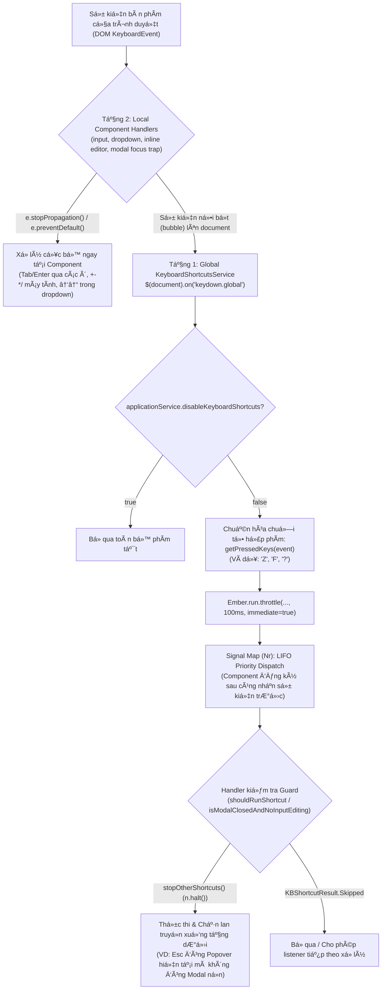

# Phân Tích Toàn Diện Phím Tắt Thao Tác (Keyboard UX) Trong YNAB Ember & Kế Hoạch Triển Khai

## Mục Tiêu (Goal Description)

Giải mã 100% kiến trúc xử lý bàn phím, hệ thống phím tắt (`keyboard-shortcuts` service), các bộ lắng nghe cục bộ (`onKeyDown` / `onKeyPress` / `onFocusTrap`) và các quy tắc UX thao tác bàn phím trong mã nguồn gốc YNAB Ember ([wrapper.renamed.js](file:///c:/Users/hoang/Desktop/ynabx/unminified/wrapper.renamed.js) và [main.renamed.js](file:///c:/Users/hoang/Desktop/ynabx/unminified/main.renamed.js)), từ đó làm cơ sở kỹ thuật chính xác để tài liệu hóa hoặc triển khai đồng bộ (pixel-perfect & behavior-perfect) sang ứng dụng React ([clone/](file:///c:/Users/hoang/Desktop/ynabx/clone) / [frontend/](file:///c:/Users/hoang/Desktop/ynabx/frontend)).

---

## 1. Kiến Trúc Tổng Thể Hệ Thống Bàn Phím Trong Ember

YNAB Ember thiết kế thao tác bàn phím theo **kiến trúc lai 2 tầng (Two-Tier Hybrid Keyboard Architecture)**:



---

## 2. Giải Mã Chi Tiết Tầng 1: `KeyboardShortcutsService` (`Px`)

**Vị trí mã nguồn**: [wrapper.renamed.js](file:///c:/Users/hoang/Desktop/ynabx/unminified/wrapper.renamed.js#L129842-L130272) (được đăng ký vào DI container với tên `"ynab_web/services/keyboard-shortcuts"` tại [main.renamed.js](file:///c:/Users/hoang/Desktop/ynabx/unminified/main.renamed.js#L52028)).

### 2.1. Chuẩn hóa mã phím (`a$`, `u$`, `d$`)
**Vị trí**: [wrapper.renamed.js](file:///c:/Users/hoang/Desktop/ynabx/unminified/wrapper.renamed.js#L121388-L121438).
1. **Kiểm tra `defaultPrevented`**: Nếu `event.isDefaultPrevented()` là `true`, hàm `a$(event)` trả về `null` ngay lập tức để tránh kích hoạt phím tắt khi sự kiện đã bị chặn ở tầng dưới.
2. **Ánh xạ phím chuẩn (`t$`)**:
   - `Enter` $\rightarrow$ `"<enter>"`
   - `Backspace` / `Delete` $\rightarrow$ `"<delete>"` (lưu ý cả hai đều quy về `"<delete>"` trong `t$`, nhưng bảng `keys` cũng khai báo dự phòng `["<backspace>"]`)
   - `Escape` / `Esc` $\rightarrow$ `"<escape>"`
   - `Tab` $\rightarrow$ `"<tab>"`
   - `ArrowLeft` / `Left` $\rightarrow$ `"<left>"`, `ArrowRight` / `Right` $\rightarrow$ `"<right>"`, `ArrowUp` / `Up` $\rightarrow$ `"<up>"`, `ArrowDown` / `Down` $\rightarrow$ `"<down>"`
   - `" "` / `Spacebar` $\rightarrow$ `"<space>"`
   - Chữ cái & chữ số (`a-z`, `0-9`) được viết hoa (`toUpperCase()`).
   - Fallback cho trình duyệt cũ qua bảng mã `keyCode` (`Qw[event.keyCode]`, bao gồm cả phím Numpad `<num-0>`..`<num-9>`, `<num-+>`, `<num-->`).
3. **Quy tắc khử `<shift>` thông minh trên ký tự đặc biệt (`u$` / `isShiftedKey`)**:
   - Mảng `i$ = ["<", ">", "?", ":", '"', "{", "}", "|", "_", "+", "!", "@", "#", "$", "%", "^", "&", "*", "(", ")"]`.
   - Trong `getPressedModifiers(key, event)`:
     ```js
     e.metaKey && n.push("<meta>");
     e.ctrlKey && n.push("<control>");
     e.altKey && n.push("<alt>");
     e.shiftKey && !u$(t) && n.push("<shift>");
     return n.sort();
     ```
   - **Ý nghĩa UX**: Khi người dùng bấm `Shift + /` để ra dấu `?` (mở bảng trợ giúp) hoặc `Shift + .` để ra dấu `>` (đóng/mở Sidebar), trình duyệt báo `event.shiftKey === true` và `event.key === "?"` (hoặc `">"`). Nhờ `!u$(t)`, `<shift>` **không** bị nối thêm vào chuỗi, giúp chuỗi khớp chính xác với `"?"` và `">"` trên mọi bố cục bàn phím quốc tế.

### 2.2. Cơ chế LIFO Priority Stack (`Nr` Signal) & `stopOtherShortcuts()`
**Vị trí**: [wrapper.renamed.js](file:///c:/Users/hoang/Desktop/ynabx/unminified/wrapper.renamed.js#L11435-L11490) và [wrapper.renamed.js](file:///c:/Users/hoang/Desktop/ynabx/unminified/wrapper.renamed.js#L130211-L130252).
- Mỗi chuỗi phím (ví dụ `"<escape>"`) ánh xạ tới một đối tượng `Signal` (`Nr`) trong `this.signalMap`.
- Khi một component gọi `registerShortcut(shortcutEnum, target, callback)` trong `constructor`:
  - Độ ưu tiên (`priority`) được gán bằng `t.getNumListeners()` (tăng dần theo thứ tự thời gian mount).
  - Khi `Signal.dispatch(...)` chạy, vòng lặp duyệt ngược từ cuối mảng `_bindings` về đầu (`do { e--; } while (n[e] && this._shouldPropagate ...)`), tức là **LIFO (Last-In, First-Out)**.
- **Ví dụ thực tế**:
  1. Màn hình `AccountRegister` mount trước, đăng ký `<escape>` (`DeselectAllTransactions`).
  2. Người dùng mở `ManagePayeesModal` (đăng ký `<escape>` $\rightarrow$ `CloseModal`).
  3. Trong `ManagePayeesModal`, người dùng mở tiếp `Popover/Sub-modal` (đăng ký `<escape>` $\rightarrow$ `CloseModal`).
  4. Khi bấm `Esc`, Popover trong cùng nhận sự kiện đầu tiên, gọi `t.stopOtherShortcuts()` (`n.halt()`), chỉ đóng Popover đó mà **không** đóng `ManagePayeesModal` và **không** bỏ chọn các dòng giao dịch bên dưới.
- **Throttle chống lặp phím**: `globalKeydownHandler` bọc lệnh `dispatch` trong `N(this, fn, 100, true)` (Ember `run.throttle` 100ms với `immediate: true`), ngăn việc đè phím gây lag giao diện.

### 2.3. Hai cổng kiểm soát trạng thái (Guard Conditions)
1. **Cờ tắt toàn cục (`disableKeyboardShortcuts`)**:
   - LÆ°u trong User Setting: `SettingNames.DisableKeyboardShortcuts = "disable_keyboard_shortcuts"` (`"1"` / `"0"`).
   - Khi bật cờ này, `globalKeydownHandler` return sớm, đồng thời component hiển thị nhãn phím tắt `<ShortcutKeys>` tự động ẩn toàn bộ các badge phím tắt trên UI (trừ trong modal Keyboard Shortcuts Help nơi có `@alwaysShow={{true}}` và nút **"Enable Shortcuts"**).
2. **Kiểm tra trạng thái Modal & Input (`isModalClosedAndNoInputEditing`)**:
   ```js
   get isModalClosedAndNoInputEditing() {
     return !(
       $(".modal-overlay").hasClass("active") ||
       $(".dialog-overlay").hasClass("active") ||
       $(".ynab-grid-body-row.is-editing").length ||
       $(".ynab-new-currency-input.is-editing").length
     );
   }
   ```
   - Ngăn các phím tắt đơn (như `A`, `C`, `E`, `K`, `M`, `S`, `>`) vô tình kích hoạt khi người dùng đang mở modal, đang sửa dòng giao dịch, hoặc đang gõ số tiền vào ô `ynab-new-currency-input`.

---

## 3. Bảng Danh Mục Đầy Đủ 57 Định Nghĩa Phím Tắt (`SHORTCUT_DEFINITIONS` / `Dx`)

**Vị trí**: [wrapper.renamed.js](file:///c:/Users/hoang/Desktop/ynabx/unminified/wrapper.renamed.js#L129851-L130184) và chuỗi i18n tại [wrapper.renamed.js](file:///c:/Users/hoang/Desktop/ynabx/unminified/wrapper.renamed.js#L4173-L4221).

> [!NOTE]
> YNAB tách biệt **hiển thị trên bảng Help (`uiLocation`, `uiAll`, `uiMac`)** với **tổ hợp phím thực thi (`keys`)**. Một số mục chỉ dùng để hiển thị gom nhóm trên bảng Help (`keys: []`, ví dụ `↑/↓` cho `MoveBetweenBudgetRows`), trong khi việc bắt phím thực tế được tách thành các hằng số có `uiLocation: "none"` (`SelectNextCategory`, `SelectPreviousCategory`) hoặc xử lý ở tầng Local Handler.

### 3.1. Nhóm Universal (`uiLocation: "universal"`)
| Enum (`Ex` / `Ot`) | Nhãn UI (`uiAll` / `uiMac`) | Tổ hợp phím thực tế (`keys`) | Mô tả & Nơi đăng ký |
| :--- | :--- | :--- | :--- |
| `OpenShortcutHelpModal` | `?` | `["?"]` | Mở/đóng modal trợ giúp phím tắt (`EvergreenApp`, `KeyboardShortcutsModal`) |
| `ToggleSidebar` | `shift` `.` | `[">"]` | Thu gọn / mở rộng thanh Sidebar trái (`Sidebar`, trừ route `users.budgets`) |
| `SelectAllTransactions` | `ctrl` `A` / `⌘` `A` | `["<meta>", "A"]`, `["<control>", "A"]` | Chọn tất cả giao dịch trên sổ cái (`RegisterGrid`) |
| `DeselectAllTransactions` | `escape` | `["<escape>"]` | Bỏ chọn toàn bộ giao dịch hoặc thoát chế độ Reconcile Adjustment (`RegisterGrid`) |
| `MathOperations` | `+`, `-`, `x`, `/` | `[]` *(Local handler)* | Phép tính cộng/trừ/nhân/chia/lũy thừa trực tiếp trong ô tiền tệ (`ynab-new-currency-input`) |
| `Undo` | `ctrl` `Z` / `⌘` `Z` | `["<meta>", "Z"]`, `["<control>", "Z"]` | Hoàn tác thay đổi (`EvergreenApp`, `ManagePayeesModal`) |
| `Redo` | `ctrl` `shift` `Z` / `⌘` `shift` `Z` | `["<meta>", "Y"]`, `["<control>", "Y"]`, `[["<meta>", "<shift>"], "Z"]`, `[["<control>", "<shift>"], "Z"]` | Làm lại thay đổi (`EvergreenApp`, `ManagePayeesModal`) |

### 3.2. Nhóm Plan / Budget Actions (`uiLocation: "budget"` & các phím ẩn đi kèm)
| Enum (`Ex` / `Ot`) | Nhãn UI (`uiAll` / `uiMac`) | Tổ hợp phím thực tế (`keys`) | Hành vi UX trong `BudgetTable` ([main.renamed.js](file:///c:/Users/hoang/Desktop/ynabx/unminified/main.renamed.js#L25374-L25583)) |
| :--- | :--- | :--- | :--- |
| `MoveBetweenBudgetRows` | `↑/↓` | `[]` *(Đại diện UI cho 2 phím dưới)* | Hiển thị trong Help Modal |
| `SelectNextCategory` | *(Ẩn)* | `["<down>"]` | Di chuyển xuống dòng Category tiếp theo và mở ô nhập `Assigned` (xoay vòng từ cuối lên đầu, throttle 50ms) |
| `SelectPreviousCategory` | *(Ẩn)* | `["<up>"]` | Di chuyển lên dòng Category phía trên và mở ô nhập `Assigned` (xoay vòng từ đầu xuống cuối, throttle 50ms) |
| `SelectMultipleCategories` | `shift` `↑/↓` | `[]` *(Đại diện UI cho 2 phím dưới)* | Hiển thị trong Help Modal |
| `SelectAllNextCategory` | *(Ẩn)* | `["<shift>", "<down>"]` | Mở rộng/thu hẹp vùng tick chọn nhiều Category xuống dưới tính từ `multipleSelectOriginItemIndex` (đồng thời đóng ô đang sửa) |
| `SelectAllPreviousCategory` | *(Ẩn)* | `["<shift>", "<up>"]` | Mở rộng/thu hẹp vùng tick chọn nhiều Category lên trên tính từ `multipleSelectOriginItemIndex` |
| `ToggleAllCategoryGroups` | `ctrl` `↑/↓` / `⌘` `↑/↓` | `[]` *(Đại diện UI cho 2 phím dưới)* | Hiển thị trong Help Modal |
| `CollapseAllCategoryGroups` | *(Ẩn)* | `["<meta>", "<up>"]`, `["<control>", "<up>"]` | Thu gọn toàn bộ các nhóm Master Category |
| `ExpandAllCategoryGroups` | *(Ẩn)* | `["<meta>", "<down>"]`, `["<control>", "<down>"]` | Mở rộng toàn bộ các nhóm Master Category |
| `SelectAllCategories` | *(Ẩn)* | `["<meta>", "A"]`, `["<control>", "A"]` | Tick chọn tất cả các dòng Category (kể cả dòng Uncategorized Transactions nếu đang hiện) |
| `DeselectAllCategories` | *(Ẩn)* | `["<escape>"]` | Bỏ tick chọn tất cả các dòng Category |
| `SnoozeSelectedCategories` | `shift` `Z` | `["<shift>", "Z"]` | Tạm ẩn (Snooze/Unsnooze) Target trong tháng hiện tại cho các Category đang chọn (gộp trong 1 ChangeSet nguyên tử) |

### 3.3. Nhóm Account Actions (`uiLocation: "accounts"` & các phím ẩn đi kèm)
| Enum (`Ex` / `Ot`) | Nhãn UI (`uiAll` / `uiMac`) | Tổ hợp phím thực tế (`keys`) | Nơi xử lý & Hành vi UX |
| :--- | :--- | :--- | :--- |
| `AddNewTransaction` | `shift` `N` | `["<shift>", "N"]`, `[["<alt>", "<control>"], "N"]`, `["<control>", "N"]` | Mở dòng thêm giao dịch mới (`RegisterGrid`) |
| `Approve` | `A` | `["A"]` | Duyệt các giao dịch đang chọn (`RegisterActionBar`) |
| `ApproveAll` | `shift` `L` | `["<shift>", "L"]` | Chọn tất cả $\rightarrow$ Duyệt tất cả $\rightarrow$ Bỏ chọn tất cả (`RegisterGrid`) |
| `Reject` | `shift` `R` | `["<shift>", "R"]` | Từ chối giao dịch nhập tự động đang chọn (`RegisterActionBar`) |
| `Categorize` | `K` | `["K"]` | Nếu chọn **1 dòng**: bắt đầu sửa dòng và focus thẳng vào ô `subCategoryName` (`RegisterGrid`). Nếu chọn **>1 dòng**: mở Popover chọn Category trên Action Bar (`RegisterActionBar`). |
| `Split` | `S` | `["S"]` | Nếu chọn **1 dòng**: mở chế độ sửa (nếu chưa sửa) và tách giao dịch thành Split Transaction (`RegisterGrid`) |
| `EnterNow` | `E` | `["E"]` | Nhập ngay giao dịch định kỳ (Scheduled) hoặc Pending vào sổ cái (`RegisterActionBar`) |
| `Match` | `M` | `["M"]` | Ghép (Match) 2 giao dịch đang chọn (`RegisterActionBar`) |
| `Unmatch` | `shift` `U` | `["<shift>", "U"]` | Hủy ghép (Unmatch) giao dịch (`RegisterActionBar`) |
| `ToggleCleared` | `C` | `["C"]` | Đảo trạng thái Cleared / Uncleared cho các giao dịch đang chọn (`RegisterGrid`) |
| `Duplicate` | `shift` `D` | `["<shift>", "D"]` | Nhân bản các giao dịch đang chọn (`RegisterActionBar`) |
| `Flag` | `shift` `F` `then` `0‑6` | `["<shift>", "F"]` | Mở menu chọn cờ màu: nếu chọn **1 dòng** thì mở dropdown tại pill cờ của dòng đó (`RegisterGrid`); nếu chọn **>1 dòng** thì mở menu cờ tại Action Bar (`RegisterActionBar`). Khi menu cờ mở (`FlagsList`), nó đăng ký tiếp phím `0`–`6`! |
| `FlagNone` .. `FlagPurple` | `0` .. `6` | `["0"]` .. `["6"]` | Chỉ được đăng ký khi component `FlagsList` ([wrapper.renamed.js](file:///c:/Users/hoang/Desktop/ynabx/unminified/wrapper.renamed.js#L159530)) đang mở: `0`=Clear, `1`=Red, `2`=Orange, `3`=Yellow, `4`=Green, `5`=Blue, `6`=Purple. |
| `MakeRepeating` | `shift` `T` | `["<shift>", "T"]` | Biến giao dịch đang chọn thành giao dịch lặp lại (`RegisterActionBar`) |
| `DeleteTransactions` | `delete` | `["<delete>"]`, `["<backspace>"]` | Xóa các giao dịch đang chọn (nếu xóa nhiều dòng hoặc dòng đã Reconciled/Closed account sẽ bật modal cảnh báo) (`RegisterGrid`) |
| `Reconcile` | `shift` `E` | `["<shift>", "E"]` | Mở luồng đối soát tài khoản (Reconcile) nếu không phải đang ở view "All Accounts" (`RegisterHeader`) |
| `FocusSearch` | `ctrl` `shift` `F` / `⌘` `shift` `F` | `[["<meta>", "<shift>"], "F"]`, `[["<control>", "<shift>"], "F"]` | Focus vào ô tìm kiếm giao dịch (`TransactionSearch`) hoặc ô tìm kiếm Payee nếu đang mở `ManagePayeesModal` |
| `StartEditingTransaction` | `enter` | `["<enter>"]` | Khi đang chọn đúng 1 dòng giao dịch và chưa ở chế độ sửa: bắt đầu sửa dòng đó và focus vào ô `date` (`RegisterGrid`) |
| `SelectNextTransaction` | *(Ẩn - `↑/↓`)* | `["<down>"]` | Chọn duy nhất dòng giao dịch kế tiếp bên dưới (bỏ qua dòng sub-transaction/footer/header, cuộn tới đầu/cuối nếu chạm biên) |
| `SelectPreviousTransaction` | *(Ẩn - `↑/↓`)* | `["<up>"]` | Chọn duy nhất dòng giao dịch phía trên |
| `SelectAllNextTransaction` | *(Ẩn - `shift` `↑/↓`)* | `["<shift>", "<down>"]` | Mở rộng/thu hẹp vùng chọn nhiều giao dịch xuống dưới quanh `selectNextOriginItemIndex` |
| `SelectAllPreviousTransaction` | *(Ẩn - `shift` `↑/↓`)* | `["<shift>", "<up>"]` | Mở rộng/thu hẹp vùng chọn nhiều giao dịch lên trên quanh `selectNextOriginItemIndex` |
| `SelectGroupOfTransactions` | `shift` `click` | `[]` *(Click handler)* | Chọn dải giao dịch liên tiếp bằng `Shift + Click` |
| `MoveToNextTransactionField` | `tab` | `[]` *(Local handler)* | Chuyển sang trường tiếp theo khi đang sửa giao dịch |
| `MoveToPreviousTransactionField` | `shift` `tab` | `[]` *(Local handler)* | Lùi về trường trước đó khi đang sửa giao dịch |

### 3.4. Nhóm Date Picker (`uiLocation: "datePicker"` & các phím ẩn đi kèm)
Được đăng ký khi `RegisterCalendar` ([main.renamed.js](file:///c:/Users/hoang/Desktop/ynabx/unminified/main.renamed.js#L45020)) đang mở:
| Enum (`Ex` / `Ot`) | Nhãn UI (`uiAll`) | Tổ hợp phím thực tế (`keys`) | Hành vi UX |
| :--- | :--- | :--- | :--- |
| `DatePickerNavigate` | `↑`, `↓`, `←`, `→` | `[]` *(Đại diện UI)* | Điều hướng ngày trên lịch |
| `DatePickerOneDayForward` | `+` | `["+"]`, `["<right>"]`, `["<num-+>"]`, `["="]` | Tăng 1 ngày (`+1 day`) |
| `DatePickerOneDayBackward` | `-` | `["-"]`, `["<left>"]`, `["<num-->"]` | Giảm 1 ngày (`-1 day`). **Lưu ý tinh tế**: Nếu phím bấm là `"-"`, hệ thống kiểm tra `dateFormatter.getSelectedDateFormat()?.includes("-")` — nếu định dạng ngày của người dùng có chứa dấu gạch ngang (ví dụ `YYYY-MM-DD` hoặc `DD-MM-YYYY`), phím `"-"` sẽ trả về `Skipped` để người dùng có thể tự gõ ngày bằng tay mà không bị nhảy lùi 1 ngày! |
| `DatePickerOneWeekForward` | *(Ẩn)* | `["<down>"]` | Tăng 1 tuần (`+7 days`) |
| `DatePickerOneWeekBackward` | *(Ẩn)* | `["<up>"]` | Giảm 1 tuần (`-7 days`) |
| `DatePickerToday` | `T` | `["T"]` | Chọn ngày hôm nay (`Today`) |
| `DatePickerFirstDayOfMonth` | `M` | `["M"]` | Chọn ngày đầu tháng đang hiển thị (`startOfMonth()`) |
| `DatePickerLastDayOfMonth` | `shift` `M` | `["<shift>", "M"]` | Chọn ngày cuối tháng đang hiển thị (`endOfMonth()`) |
| `DatePickerFirstDayOfYear` | `Y` | `["Y"]` | Chọn ngày đầu năm đang hiển thị (`startOfYear()`) |
| `DatePickerLastDayOfYear` | `shift` `Y` | `["<shift>", "Y"]`, `["R"]` | Chọn ngày cuối năm đang hiển thị (`endOfYear()`) — hỗ trợ cả `Shift+Y` và phím đơn `R`! |

### 3.5. Nhóm Modal & Dialog (`uiLocation: "none"`)
| Enum (`Ex` / `Ot`) | Tổ hợp phím (`keys`) | Nơi đăng ký & Hành vi UX |
| :--- | :--- | :--- |
| `CloseModal` | `["<escape>"]` | Đóng Modal/Dialog/Menu/Overlay/Calendar hiện hành và gọi `stopOtherShortcuts()` |
| `SubmitModal` | `["<enter>"]` | Xác nhận lưu trong modal sửa giao dịch đã Reconciled (`EditReconciledTransactionModal`) |
| `ManagePayeeEnter` | `["<enter>"]` | Trong `ManagePayeesModal`: đóng sub-modal nếu đang mở, xác nhận xóa Payee nếu đang hiện hộp thoại xác nhận xóa, hoặc kích hoạt nút `.button-primary` cùng cấp với input đang focus |

---

## 4. Giải Mã Chi Tiết Tầng 2: Local Component Keyboard UX

Ngoài `KeyboardShortcutsService`, phần lớn trải nghiệm "mượt" khi nhập liệu của YNAB nằm ở các bộ xử lý sự kiện bàn phím cục bộ:

### 4.1. Máy tính tiền tệ Inline (`ynab-new-currency-input`)
**Vị trí**: [wrapper.renamed.js](file:///c:/Users/hoang/Desktop/ynabx/unminified/wrapper.renamed.js#L160815-L160905).
- **Kích hoạt phép tính (`onKeyPress`)**:
  - Khi gõ các toán tử `+`, `-`, `*`, `/`, `%`, `^`, `=` (`Ui(n)`):
  - **Quy tắc số âm / dấu cộng đầu dòng**: Nếu giá trị hiện tại bằng `0` (`formatter.clean(editValue) === 0`) và người dùng gõ `"-"` (hoặc `"+"` khi `@allowLeadingPlusSign` bật như ở màn hình Reconcile), nó được hiểu là dấu âm/dương của con số chứ **không** mở máy tính.
  - Ngược lại, nếu toàn bộ văn bản trong ô đang được bôi đen (`i0(e)` — trạng thái vừa focus vào ô tiền tệ trên dòng Budget), việc gõ `+`, `-`, `*`, `/` sẽ **không xóa số cũ** mà nối toán tử vào sau số cũ (`r + t`), bỏ bôi đen và đặt con trỏ về cuối chuỗi (`focusAndSelect(r0.end)`) để người dùng cộng/trừ thêm vào số tiền hiện có!
  - Nếu ký tự cuối cùng đã là một toán tử mà người dùng gõ toán tử khác, toán tử cuối sẽ được thay thế bằng toán tử mới.
- **Tính kết quả & Lưu (`onKeyDown`)**:
  - `Ctrl/Cmd + Enter` khi đang có biểu thức toán học: chỉ tính ra kết quả (`this.calculate("=")`) và giữ focus trong ô để xem kết quả trước khi lưu.
  - `Enter`, `Tab`, `ArrowUp`, `ArrowDown`: gọi `commitValue()` (tính biểu thức toán học qua parser `Ki()`, quy đổi ra milliunits giới hạn trong `±1e15`, lưu giá trị và đóng popup calculator).
  - Đặc biệt, khi bấm `ArrowUp` hoặc `ArrowDown` trong ô `Assigned` của `BudgetTable`:
    - `ynab-new-currency-input` đánh dấu `forceCommitOnNextFocusOut = true` và gọi `commitValue()`, nhưng **không** gọi `stopPropagation()` đối với `<up>` / `<down>`.
    - Nhờ đó sự kiện `<up>` / `<down>` tiếp tục nổi bọt lên `document`, kích hoạt `SelectPreviousCategory` / `SelectNextCategory` của `BudgetTable` $\rightarrow$ **vừa lưu số tiền ở dòng hiện tại, vừa nhảy ngay sang mở ô nhập tiền ở dòng Category kế tiếp!**
  - `Escape`:
    - Nếu popup máy tính (`showCalculatorPopup`) đang mở $\rightarrow$ chỉ đóng popup máy tính (`stopPropagation()`).
    - Nếu giá trị trong ô đã bị sửa đổi (`_hasValueChanged()`) $\rightarrow$ khôi phục `previousValue` và blur khỏi ô (`stopPropagation()`).
    - Nếu giá trị chưa đổi $\rightarrow$ `budget-table-row` (`onKeyDown` tại [main.renamed.js](file:///c:/Users/hoang/Desktop/ynabx/unminified/main.renamed.js#L25087)) bắt `<escape>` và gọi `tryToCancelEditing(categoryId)`.

### 4.2. Điều hướng khi Thêm / Sửa Giao dịch trên Sổ cái (`RegisterGrid` & `TransactionEditorService`)
**Vị trí**: [main.renamed.js](file:///c:/Users/hoang/Desktop/ynabx/unminified/main.renamed.js#L22856-L22950), [main.renamed.js](file:///c:/Users/hoang/Desktop/ynabx/unminified/main.renamed.js#L43115-L43130), [main.renamed.js](file:///c:/Users/hoang/Desktop/ynabx/unminified/main.renamed.js#L45829-L45860).
- **Thứ tự vòng lặp các trường (`registerAreaOrder`)**:
  `Account` (nếu ở All Accounts) $\rightarrow$ `Date` $\rightarrow$ `Payee` $\rightarrow$ `Category` $\rightarrow$ `Memo` $\rightarrow$ `Outflow` $\rightarrow$ `Inflow` $\rightarrow$ Nút `Save` / `Save and Add Another` / `Cancel`.
- **Phím `Tab` và `Shift + Tab` (`grid-index.hbs` `onKeyDown`)**:
  - **Focus Trap vòng tròn trên dòng đang sửa**:
    - Nếu đang ở input đầu tiên của dòng sửa và bấm `Shift + Tab` $\rightarrow$ nhảy vòng xuống nút `.button-primary` cuối cùng (`Save` hoặc `Save and Add Another`).
    - Nếu đang ở nút `.button-primary` cuối cùng và bấm `Tab` $\rightarrow$ nhảy vòng lại về input đầu tiên của dòng sửa.
  - **Nhảy thông minh qua ô Outflow khi thu nhập (`ImmediateIncomeSubCategory`)**:
    - Nếu giao dịch có Category là `Inflow: Ready to Assign` (`ImmediateIncomeSubCategory`), khi đang ở ô `Memo` và bấm `Tab`, con trỏ **bỏ qua ô Outflow** và nhảy thẳng vào ô `Inflow`!
  - **Loại trừ lẫn nhau giữa `Inflow` và `Outflow` (`grid-edit.hbs` `onInput`)**:
    - Ngay khi người dùng gõ vào ô `Inflow`, giá trị trong ô `Outflow` tự động bị xóa rỗng (`""`) và ngược lại.
  - **Focus Trap trên Action Bar khi đang chọn giao dịch (không sửa)**:
    - Nếu có $\ge 1$ giao dịch đang được tick chọn (thanh Action Bar màu xanh hiển thị ở dưới), bấm `Tab` sẽ đưa focus vào nút đầu tiên trên Action Bar và xoay vòng `Tab` / `Shift + Tab` giữa các nút trong Action Bar.
- **Phím `Enter` khi đang sửa giao dịch**:
  - Nếu đang ở ô `Date`, `Account`: lưu giá trị trường hiện tại và gọi `focusOnNextField()` (chuyển sang ô kế tiếp, bỏ qua ô bị `disabled` như Category của giao dịch Transfer).
  - Nếu đang ở ô `Payee` hoặc `Category`: dropdown `register-payees` / `register-categories` bắt `Enter`, chọn mục đang highlight (hoặc mở form tạo Category mới / tách Split / chuyển sang Payee nếu chọn "Payment or Transfer"), tự động điền Category gợi ý theo Payee (`autoFillFieldsBasedOnPayee`), rồi gọi `focusOnNextField()` (nếu là giao dịch trả thẻ tín dụng thì nhảy thẳng tới `Memo`).
  - Nếu đang ở ô `Memo`, `Outflow`, hoặc `Inflow`: bấm `Enter` sẽ **kích hoạt ngay nút `.button-primary-small:last`** (nếu đang thêm giao dịch mới thì kích hoạt **"Save and Add Another"**, nếu đang sửa giao dịch cũ thì kích hoạt **"Save"** / **"Approve"**)!
- **Phím `Escape` khi đang sửa giao dịch**:
  - Nếu không có modal báo lỗi đang mở, hủy ngay chế độ chỉnh sửa dòng (`this.cancel()`).

### 4.3. Điều hướng trong các Dropdown & Modal đặc biệt
1. **Dropdown tìm kiếm giao dịch (`TransactionSearch` - [main.renamed.js](file:///c:/Users/hoang/Desktop/ynabx/unminified/main.renamed.js#L41563-L41570))**:
   - `onKeyDown` gọi `event.stopPropagation()` để ngăn phím mũi tên làm nhảy dòng giao dịch bên dưới.
   - `<down>` / `<up>`: di chuyển `selectedIndex` xoay vòng qua danh sách gợi ý (`recommendations`).
   - `<escape>`: đóng danh sách gợi ý (`cancelRecommendation()`).
   - `<enter>`: chọn gợi ý đang highlight (hoặc xóa bộ lọc nếu đang focus nút clear / chuỗi rỗng).
2. **Dropdown danh mục trong Move Money / Cover Overspending (`CategoriesDropdown` - [wrapper.renamed.js](file:///c:/Users/hoang/Desktop/ynabx/unminified/wrapper.renamed.js#L162436-L162453))**:
   - Hỗ trợ tìm kiếm mờ (fuzzy search), phím `<up>` / `<down>` di chuyển qua các mục không phải tiêu đề nhóm (`!item.isSectionItem`) và tự động cuộn vùng `.dropdown-modal-body`, phím `<enter>` chọn Category.
   - Trong `MoveMoneyModal` ([wrapper.renamed.js](file:///c:/Users/hoang/Desktop/ynabx/unminified/wrapper.renamed.js#L163344)): nếu bấm `<enter>` khi nút "OK" còn bị disable (chưa điền đủ số tiền hoặc chưa chọn Category), focus sẽ tự động nhảy sang ô `input` còn lại trong modal! Khi đã đủ cả hai, bấm `<enter>` thực thi `moveMoney()` ngay.
3. **Modal xác nhận xóa giao dịch / gộp Split (`DeleteTransactionsWarning`, `ConfirmCategorizingSplits` - [wrapper.renamed.js](file:///c:/Users/hoang/Desktop/ynabx/unminified/wrapper.renamed.js#L158934-L159005))**:
   - Cho phép xác nhận xóa nhanh bằng `<enter>` **HOẶC** `Ctrl/Cmd + Backspace/Delete` (`"<delete>" === e && (event.metaKey || event.ctrlKey)`), và hủy bằng `<escape>`.
4. **Focus Trap & Enter Submit trong Base Modal (`Modal` - [wrapper.renamed.js](file:///c:/Users/hoang/Desktop/ynabx/unminified/wrapper.renamed.js#L158646-L158696))**:
   - Khi mở modal, tự động focus vào phần tử `.js-focus-on-start`.
   - `onFocusTrap`: Giữ vòng lặp `Tab` / `Shift + Tab` bên trong các phần tử khả dụng (`button, [href], input, select, textarea, [tabindex]:not([tabindex="-1"])`) của modal.
   - `onKeyPress`: Khi bấm `Enter` (trừ khi truyền `@preventActionOnEnter`), tự động tìm và click `.button-primary` hoặc `button.primary` nếu nút đó không bị disabled.
5. **Ghi chú tháng ngân sách (`BudgetMonthTextarea` - [wrapper.renamed.js](file:///c:/Users/hoang/Desktop/ynabx/unminified/wrapper.renamed.js#L163406-L163420))**:
   - `Enter` (không giữ `Shift`): lưu ghi chú ngay (`this.args.save()`).
   - `Shift + Enter`: xuống dòng mới trong textarea và tự động giãn chiều cao (`_autogrow()`).
   - `Escape`: hủy chỉnh sửa ghi chú (`this.args.cancel()`).
6. **Hệ thống Toast Mẹo Phím Tắt (`ToastService` - [wrapper.renamed.js](file:///c:/Users/hoang/Desktop/ynabx/unminified/wrapper.renamed.js#L200344))**:
   - Khi người dùng thực hiện thao tác bằng **chuột** (`"click" == e?.type`) đối với các hành động như Approve, Match, Split, Snooze Target, YNAB hiển thị một Toast nhỏ ở góc dưới: *"Keyboard Tip: Press [A] to approve..."* kèm component `<ShortcutKeys>` để huấn luyện người dùng dùng phím tắt.

---

## 5. So Sánh Khoảng Cách Hiện Tại (Gap Analysis) Trong Dự Án

Qua kiểm tra mã nguồn hiện tại trong [clone/](file:///c:/Users/hoang/Desktop/ynabx/clone) và [frontend/](file:///c:/Users/hoang/Desktop/ynabx/frontend):
- [clone/src/components/modals/KeyboardShortcutsModal.tsx](file:///c:/Users/hoang/Desktop/ynabx/clone/src/components/modals/KeyboardShortcutsModal.tsx) và [frontend/src/components/modals/KeyboardShortcutsModal.tsx](file:///c:/Users/hoang/Desktop/ynabx/frontend/src/components/modals/KeyboardShortcutsModal.tsx) hiện mới chỉ là bảng tạm (7–9 dòng tĩnh, dùng phím giả như `/` hoặc `R` thay vì đúng chuẩn Ember là `?`, `Shift+E`, `Ctrl/Cmd+Shift+F`, và chưa chia thành 4 phân vùng `Universal`, `Plan Actions`, `Account Actions`, `Date Picker` kèm banner bật/tắt `disableKeyboardShortcuts`).
- Chưa có dịch vụ điều phối trung tâm tương đương `KeyboardShortcutsService` với cơ chế LIFO priority stack (`stopOtherShortcuts`) và bộ chuẩn hóa phím (`isShiftedKey`).
- Nhiều phím tắt thao tác nhanh trên lưới Budget (`↑/↓`, `Shift+↑/↓`, `Ctrl/Cmd+↑/↓`, `Ctrl/Cmd+A`, `Shift+Z`), trên Account Register (`Shift+N`, `A`, `Shift+L`, `Shift+R`, `K`, `S`, `E`, `M`, `Shift+U`, `C`, `Shift+D`, `Shift+F` $\rightarrow$ `0-6`, `Shift+T`, `Shift+E`) và trong Date Picker (`+`, `-`, `T`, `M`, `Shift+M`, `Y`, `Shift+Y`/`R`) chưa được kết nối đầy đủ.

---

## Open Questions

> [!IMPORTANT]
> Bạn muốn bước tiếp theo sau bản phân tích này là gì?
> 1. **Lưu thành tài liệu đặc tả kỹ thuật** (ví dụ `docs/KEYBOARD_SHORTCUTS_UX.md`) để làm tài liệu tham chiếu Reverse Engineering chuẩn?
> 2. **Triển khai toàn bộ hệ thống Phím tắt & UX bàn phím chuẩn Ember vào `clone/`** (hoặc `frontend/`): bao gồm `KeyboardShortcutsService` (LIFO stack + `disableKeyboardShortcuts`), component `<ShortcutKeys>`, `KeyboardShortcutsModal` chuẩn 4 nhóm từ `modals/keyboard-shortcuts/index.hbs`, và đầy đủ phím tắt cho Budget Table, Account Register, Action Bar, Date Picker?

---

## Proposed Changes (Nếu thực hiện triển khai code & tài liệu)

### 1. Tài liệu Reverse Engineering (`docs/`)
#### [NEW] [KEYBOARD_SHORTCUTS_UX.md](file:///c:/Users/hoang/Desktop/ynabx/docs/KEYBOARD_SHORTCUTS_UX.md)
- Lưu trữ toàn bộ kết quả giải mã kiến trúc 2 tầng, bảng 57 `SHORTCUT_DEFINITIONS`, quy tắc `isShiftedKey`, LIFO Signal stack và luồng điều hướng chi tiết từng màn hình.

---

### 2. Dịch vụ & Component Phím tắt Trung tâm (`clone/src/`)
#### [NEW] [keyboardShortcuts.ts](file:///c:/Users/hoang/Desktop/ynabx/clone/src/services/keyboardShortcuts.ts)
- Port nguyên bản `KeyboardShortcut` enum (`Ex`), `SHORTCUT_DEFINITIONS` (`Dx`), hàm chuẩn hóa phím (`normalizeKey`, `isShiftedKey`), và bộ điều phối ưu tiên LIFO (`registerShortcut`, `stopOtherShortcuts`, throttle 100ms, cờ `disableKeyboardShortcuts`).

#### [NEW] [ShortcutKeys.tsx](file:///c:/Users/hoang/Desktop/ynabx/clone/src/components/core/ShortcutKeys.tsx)
- Port component `components/keyboard-shortcuts/shortcut-keys/index.hbs` (`<div class="shortcut-keys"><div class="shortcut-key">...</div></div>`) tự động hiển thị theo OS (`macOS` vs `all`) và ẩn khi `disableKeyboardShortcuts` bật.

#### [MODIFY] [KeyboardShortcutsModal.tsx](file:///c:/Users/hoang/Desktop/ynabx/clone/src/components/modals/KeyboardShortcutsModal.tsx)
- Cập nhật đúng cấu trúc Glimmer template `components/modals/keyboard-shortcuts/index.hbs` (`@size="large"`, hộp cảnh báo `ynab-helpbox` khi phím tắt bị tắt kèm nút `Enable Shortcuts`, và 4 danh sách `Universal`, `Plan Actions`, `Account Actions`, `Date Picker` sử dụng `<ShortcutKeys @alwaysShow={true} />`).

---

### 3. Kết nối Phím tắt vào các Phân hệ UI (`clone/src/`)
#### [MODIFY] [App.tsx](file:///c:/Users/hoang/Desktop/ynabx/clone/src/App.tsx)
- Đăng ký các phím tắt toàn cục: `?` (`OpenShortcutHelpModal`), `>` (`ToggleSidebar`), `Ctrl/Cmd+Z` (`Undo`), `Ctrl/Cmd+Shift+Z` / `Ctrl/Cmd+Y` (`Redo`), `Ctrl/Cmd+Shift+F` (`FocusSearch`), và phím tắt trên Budget Table (`↑/↓`, `Shift+↑/↓`, `Ctrl/Cmd+↑/↓`, `Ctrl/Cmd+A`, `Esc`, `Shift+Z`) cùng Account Register (`Shift+N`, `C`, `A`, `Shift+L`, `Shift+R`, `K`, `S`, `E`, `M`, `Shift+U`, `Shift+D`, `Shift+F` + `0..6`, `Shift+T`, `Delete/Backspace`, `Shift+E`).

#### [MODIFY] [DatePickerPopover.tsx](file:///c:/Users/hoang/Desktop/ynabx/clone/src/components/accounts/DatePickerPopover.tsx)
- Bổ sung đầy đủ các phím tắt lịch: `+`/`→`/`=`, `-`/`←` (có kiểm tra format ngày chứa `-`), `↓`/`↑` (±1 tuần), `T` (Today), `M` / `Shift+M` (đầu/cuối tháng), `Y` / `Shift+Y` / `R` (đầu/cuối năm).

---

## Verification Plan

### Automated Tests
- Chạy kiểm tra typecheck và build cho ứng dụng thông qua lệnh chuẩn hoặc script kiểm thử:
  - Kiểm tra biên dịch TypeScript (`npm run build` trong `clone/` hoặc `make check`).
  - Viết unit test kiểm chứng bộ chuẩn hóa phím (`normalizeKey`, `isShiftedKey` với `?`, `>`), thứ tự ưu tiên LIFO và `stopOtherShortcuts()`.

### Manual Verification
- Nhấn `?` ở bất kỳ màn hình nào (khi không gõ input) để mở/đóng `KeyboardShortcutsModal` và đối chiếu giao diện 4 nhóm với Ember gốc.
- Nhấn `Shift + .` (`>`) để đóng/mở Sidebar.
- Trên bảng Budget: nhấn `↑`/`↓` để nhảy liên tiếp giữa các ô `Assigned`, gõ `+ 50 Enter` để tính toán cộng dồn, `Shift + ↑/↓` để chọn nhiều dòng, `Ctrl/Cmd + ↑/↓` để đóng/mở tất cả nhóm.
- Trên bảng Account Register: kiểm tra `Shift + N` (thêm giao dịch), `↑`/`↓` (di chuyển dòng), `C` (đổi Cleared), `K` (categorize), `Shift + F` rồi bấm `1`–`6` (gắn cờ màu), và các phím tắt trong Date Picker (`T`, `M`, `Shift+M`, `Y`, `Shift+Y`, `+`, `-`).
