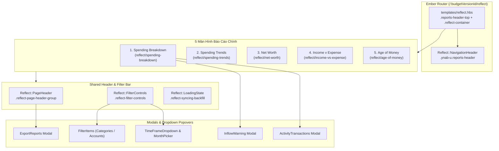

# Phân Tích Chi Tiết Phân Hệ Reflect / Reports (YNAB Ember & Slik Engine)

> **Mã nguồn giải mã**:
> - [`unminified/main.beautified.js`](file:///c:/Users/hoang/Desktop/ynabx/unminified/main.beautified.js#L62220-L66740) — Ember Route, Controller, Glimmer Templates & Component classes của `reflect/*`
> - [`unminified/wrapper.beautified.js`](file:///c:/Users/hoang/Desktop/ynabx/unminified/wrapper.beautified.js#L232435-L314650) — Slik Kotlin Multiplatform (`SpendingBreakdownUseCases`), `ReportsViewModel`, và các Modal/Popover (`time-frame-dropdown`, `filter-items`, `activity-transactions`, `export-reports`, `inflow-warning-modal`)
> - [`docs/reflect-branch-tree.md`](file:///c:/Users/hoang/Desktop/ynabx/docs/reflect-branch-tree.md) — Bảng danh mục 37 Glimmer template modules & 67 nhánh điều kiện AST
> - [`clone/src/components/reflect/`](file:///c:/Users/hoang/Desktop/ynabx/clone/src/components/reflect) — Bản dịch React + TypeScript JSX tương ứng

---

## 1. Tổng Quan Kiến Trúc Phân Hệ Reflect

Trong YNAB Web (phiên bản Evergreen), mục **Reports** cũ đã được nâng cấp và đổi tên thành **Reflect** (`/:budgetVersionId/reflect/*`). Phân hệ này kết hợp:
1. **Slik Engine (Kotlin Multiplatform biên dịch sang JS)** cho các báo cáo thế hệ mới (`Spending Breakdown`, `Age of Money`).
2. **Legacy Reports ViewModel (`reportsViewModel` / `reportsService`)** được bọc lại trong giao diện Reflect mới cho `Spending Trends`, `Net Worth`, và `Income v Expense`.



---

## 2. Shell, Routing & Shared Components

### 2.1. Router & Redirect (`main.beautified.js` dòng 3004–3013, 63700–63720)
- Route cha `reflect` nằm dưới `/:budgetVersionId/reflect` với 5 route con:
  1. `reflect.spending-breakdown`
  2. `reflect.spending-trends`
  3. `reflect.net-worth`
  4. `reflect.income-expense`
  5. `reflect.age-of-money`
  *(Route cũ `reflect.spending-totals` và `reports.spending.totals` tự động `replaceWith("reflect.spending-breakdown")`)*
- Khi vào `/reflect`, hàm `redirect()` đọc `localStorage` theo key `lastReportRoute_${budgetVersionId}`; nếu chưa có thì mặc định chuyển hướng vào `reflect.spending-breakdown`.

### 2.2. Khung Bao Ngoài (`templates/reflect.hbs` — dòng 62291)
```html
<div class="{{if this.isOnIncomeExpenseRoute '' 'content-min-break'}} reports-header-top">
  <Reflect::NavigationHeader />
  <div class="reflect-container {{if this.isOnIncomeExpenseRoute 'reflect-income-expense-container' ''}}">
    <div class="reflect-content">
      {{outlet}}
    </div>
  </div>
</div>
```
- **Lưu ý quan trọng về CSS Layout**:
  - `.reports-header-top` có `display: flex; flex-flow: column; height: 100%`.
  - Khi **không** ở tab `Income v Expense`, class `content-min-break` được gắn vào `.reports-header-top` để giới hạn bề rộng tối đa và căn giữa nội dung. Riêng tab `Income v Expense` cần cuộn ngang nhiều cột tháng nên bỏ `content-min-break` và thêm `reflect-income-expense-container`.
  - `.reflect-container` là vùng cuộn dọc chính (`overflow: auto; height: 100%; padding: 0 2rem 3.5rem; background: var(--backgroundGroupedPrimary)`).

### 2.3. Thanh Điều Hướng 5 Tab (`components/reflect/navigation-header/index.hbs` — dòng 62230)
- Render `<div class="ynab-u reports-header">` chứa 5 thẻ `<button type="button" class="{{if item.active 'active'}}">`.

### 2.4. Tiêu Đề Trang & Breadcrumbs (`components/reflect/page-header/index.hbs` — dòng 62392)
- Render `<div class="reflect-page-header-group">`:
  - Bên trái (`<h3 class="reflect-page-title">`):
    - **Nhánh thường**: Hiển thị `@pageTitle` (VD: `"Spending Breakdown"`).
    - **Nhánh Drilldown (`shouldShowBreadcrumbs === true`)**: Khi người dùng đang ở chế độ `Groups` của Spending Breakdown và bấm vào 1 Category Group, tiêu đề biến thành cụm breadcrumb `.reflect-breadcrumbs__selected-group-breadcrumbs`:
      `[All Groups (ghost-button)]` + `<svg #icon_sprite_chevron_right>` + `[Tên Group (disabled ghost-button)]`.
  - Bên phải (`.reflect-page-header-actions`, ẩn khi `@hideActionButtons === true` hoặc đang `isSyncingBackfill`):
    - Nút **Share Progress** (`.reflect-share-progress-button` với icon `line_chart`) — chỉ xuất hiện khi truyền `@onShareProgress` (hiện chỉ có ở tab **Net Worth**).
    - Nút **Export** (`.reflect-export-button` với icon `document_with_arrow_down`) — mở modal `modals/reports/export-reports`.

### 2.5. Thanh Bộ Lọc (`components/reflect/filter-controls` & `filter-button` — dòng 63033–63150)
- Render `<div class="reflect-filter-controls">` gồm 3 cụm:
  1. **Timeframe Group** (`.reflect-filter-button-group`):
     - Nút lùi tháng `.filter-button__left-arrow` (disabled khi `disableLeftArrow`, tức khoảng thời gian chạm `firstBudgetMonth` hoặc đang chọn `"All Dates"`). Bên trong có `<div class="filter-button__divider"></div>`.
     - Nút giữa `.filter-button--middle-state.filter-button-timeframe` (icon `calendar` 12×12 + nhãn tháng như `Nov 2026` hoặc `Oct 2025 – Sep 2026`).
     - Nút tiến tháng `.filter-button__right-arrow` (disabled khi `disableRightArrow`, tức chạm `lastBudgetMonth`).
  2. **Vạch ngăn cách**: `<div class="filter-controls-divider"></div>`.
  3. **Categories & Accounts Dropdowns**:
     - Nút `.filter-button-categories` (ẩn trên tab **Net Worth** vì Net Worth tính theo số dư tài khoản chứ không theo category):
       - Nhãn: `"All Categories"`, `"No Categories"`, hoặc `"Some Categories"` kèm badge `<span class="filter-button__pill">{{count}}</span>` (nếu `> 99` thì hiện `"99+"`).
     - Nút `.filter-button-accounts`:
       - Nhãn: `"All Accounts"`, `"No Accounts"`, hoặc `"Some Accounts"` kèm badge `.filter-button__pill`.

---

## 3. Phân Tích Chi Tiết 5 Màn Hình Báo Cáo

### 3.1. Tab 1: Spending Breakdown (`main.beautified.js` dòng 64092–65405)

Đây là màn hình phức tạp nhất của Reflect, sử dụng `spendingBreakdownUseCases` từ Slik Engine.

#### A. Bố cục 2 Cột & Cơ chế Responsive (`SINGLE_COLUMN_CUTOFF = 1004`)
- Component gắn `ResizeObserver` trực tiếp lên `.reflect-spending-breakdown`:
  $$\text{singleColumn} = (\text{clientWidth} < 1004\text{px})$$
- Khi `singleColumn === true`, cả `.reflect-spending-breakdown` và `.spending-breakdown__content` đều nhận thêm class `.single-column`, chuyển bố cục từ 2 cột ngang (`flex-direction: row`) sang xếp chồng dọc (`flex-direction: column`), đồng thời `.positive-inflows` nhận class `.no-scroll`.
- Trong `.spending-breakdown__content`:
  - **Cột trái (`.spending-breakdown__column.left`, `flex: 2`)**: Gồm 2 phần tử con ngang hàng (sister elements):
    1. Card biểu đồ tròn `.spending-breakdown__donut-card.card`
    2. Khung 4 chỉ số thống kê `.spending-breakdown__metrics` *(Lưu ý: nằm NGOÀI `.spending-breakdown__donut-card`, bên dưới card với khoảng cách `gap: 1rem`)*
  - **Cột phải (`.spending-breakdown__column.right`, `flex: 1`)**: Gồm:
    1. Card danh sách thanh ngang `.spending-breakdown__bar-card.card`
    2. (Tùy chọn) Khung `.positive-inflows` chứa card `.spending-breakdown__positive-inflows` khi có danh mục mang dòng tiền dương.

#### B. Quy tắc Nghiệp vụ & Phân loại Dữ liệu
- Dữ liệu chi tiêu được chia làm 2 tập dựa trên tổng số tiền ròng (`amount` tính bằng milliunits) của từng Category hoặc Category Group trong kỳ lọc:
  - **Net Spending (`netSpendingChartDataItems`)**: Các mục có `amount <= 0` (chi tiêu ròng).
  - **Positive Inflows (`netInflowChartDataItems`)**: Các mục có `amount > 0` (hoàn tiền / thu nhập trực tiếp vào danh mục chi tiêu lớn hơn số tiền chi ra).
- **Quy tắc Sắp xếp (`categorySortingFunction`)**:
  1. Sắp xếp theo `amount` tăng dần (tức khoản chi âm lớn nhất lên đầu: `-1200000` đứng trước `-550000`).
  2. Nếu bằng tiền nhau: sắp xếp theo tên Category (A → Z), sau đó theo tên Category Group, sau đó theo `categoryId`.
- **Quy tắc Gộp Top 10 (`TOP_ITEM_LIMIT = 10`)**:
  - Biểu đồ Donut chỉ vẽ tối đa **10 lát cắt đầu tiên** (`topNetSpendingChartDataItems`).
  - Nếu có từ 11 danh mục trở lên, toàn bộ các danh mục từ vị trí thứ 11 (`everythingElseNetSpendingChartDataItems`) được gộp thành một lát cắt thứ 11 có `id = "everythingElse"`, tên `"Everything Else"`, mang màu `--reportsSpendingBreakdownTopOther`.
  - Trong khi đó, **Bar Chart** ở cột phải vẫn hiển thị **đầy đủ tất cả các danh mục** (không gộp thành Everything Else), nhưng các danh mục từ vị trí 11 trở đi đều dùng màu `--reportsSpendingBreakdownTopOther`.
- **Quy tắc Làm tròn Phần trăm**:
  - `formatPercentageForDisplay(proportion)`: Nếu $0 < \text{proportion} \times 100 < 1$ thì hiển thị `"<1%"`, ngược lại làm tròn `Math.round(proportion * 100) + "%"`.
  - `formatChartValue(proportion)`: Giá trị truyền vào Billboard.js tối thiểu là `1` nếu $< 1\%$ để lát cắt vẫn nhìn thấy được trên vòng tròn.

#### C. Bảng Màu Chuẩn Của Donut & Bar Chart
Được lấy qua hàm `ut()` đọc biến CSS trên `:root` / `body.theme-*`:

| Thứ tự | Biến CSS | Mã HEX (Light Theme) | Mã HEX (Dark Theme) |
| :--- | :--- | :--- | :--- |
| **Top 1** | `--reportsSpendingBreakdownTop1` | `#545bfe` | `#545bfe` |
| **Top 2** | `--reportsSpendingBreakdownTop2` | `#93d53e` | `#77ba21` |
| **Top 3** | `--reportsSpendingBreakdownTop3` | `#f6c91d` | `#daac00` |
| **Top 4** | `--reportsSpendingBreakdownTop4` | `#ce5e66` | `#bf2e3b` |
| **Top 5** | `--reportsSpendingBreakdownTop5` | `#7583ff` | `#7583ff` |
| **Top 6** | `--reportsSpendingBreakdownTop6` | `#aee865` | `#93d53e` |
| **Top 7** | `--reportsSpendingBreakdownTop7` | `#f8d655` | `#f6c91d` |
| **Top 8** | `--reportsSpendingBreakdownTop8` | `#e48585` | `#ce5e66` |
| **Top 9** | `--reportsSpendingBreakdownTop9` | `#a3acff` | `#a3acff` |
| **Top 10** | `--reportsSpendingBreakdownTop10` | `#c2f680` | `#aee865` |
| **Everything Else** | `--reportsSpendingBreakdownTopOther` | `#d4d5ff` | `#d4d5ff` |
| **Empty Ring** | `--backgroundGroupedPrimary` | `#f8f6f2` | `#0c0d22` |

#### D. Chi tiết Donut Chart (`spending-breakdown/donut-chart/index.hbs` — dòng 64171–64545)
- **Tâm biểu đồ (`.spending-breakdown-donut-chart__title`)**:
  - Khi **không hover**: Hiển thị `"Total Spending"` + tổng số tiền + nút icon `info_circle_fill` (`.spending-breakdown-donut-chart_modal-trigger`) nếu `shouldShowInflowWarning === true` (tức có `Positive Inflows` và không đang hover lát cắt nào).
  - Khi **hover vào 1 lát cắt**: Đổi nhãn tâm thành tên Category/Group đang hover, số tiền của lát cắt đó, và hiện thêm `<span class="spending-breakdown-donut-chart__percentage">` bên dưới.
- **Nhãn bên ngoài vòng tròn (`outerLabels`)**:
  - Chỉ hiển thị nhãn bên ngoài kèm đường kẻ dẫn (leader lines 3 điểm uốn `<polyline>`) cho các lát cắt có tỷ trọng $\ge 5\%$ (`labelThreshold = 0.05`).

#### E. Chi tiết 4 Thẻ Thống Kê (`.spending-breakdown__metrics` — dòng 65112–65201)
Chia thành 2 dòng `.spending-breakdown__metrics-row`:
1. **Dòng 1**:
   - `Average Monthly Spending` (`.monthly-average-spending`): Trung bình chi tiêu mỗi tháng trong kỳ lọc (nếu đang drilldown vào 1 Group thì lấy trung bình tháng của riêng Group đó).
   - `Average Daily Spending` (`.daily-average-spending`): Trung bình chi tiêu mỗi ngày.
2. **Dòng 2**:
   - `Most Frequent Category` / `Most Frequent Group` (`.most-frequent-category`): Danh mục/Nhóm có số lượng giao dịch nhiều nhất, kèm subtitle `"X transactions"` (hoặc `"n/a"` nếu không có giao dịch).
   - `Largest Outflow` (`.largest-outflow`): Tên **Payee** của giao dịch chi tiêu lớn nhất trong kỳ, kèm subtitle là số tiền của giao dịch đó (hoặc `"n/a"` nếu trống).

#### F. Chi tiết Bar Chart & Positive Inflows (`bar-chart` & `positive-inflows` — dòng 64553–64765)
- **Bar Chart (`.spending-breakdown__bar-card.card`)**:
  - Header `.spending-breakdown-bar-chart-header`: Cột trái `"Categories"` (hoặc `"Groups"`), cột phải `"Total Spending"`.
  - Body `.spending-breakdown-bar-chart-body.card-body`:
    - Nếu rỗng: hiện `<div class="reflect-spending-empty-table-state"><span>No spending to show yet</span></div>`.
    - Nếu có dữ liệu: mỗi dòng là `<button class="reflect-bar-chart-row spending-breakdown-bar-chart-row">` gồm 2 dòng con `.spending-breakdown-bar-chart-section`:
      1. Tên danh mục (bọc tooltip nếu `isHidden === true`) + `<span class="amount">`.
      2. Thanh màu `<div class="spending-breakdown-bar-chart-bar" style="width: X%; background-color: Y;"></div>` + tỷ lệ `%`.
    - Khi bấm vào 1 dòng:
      - Nếu đang ở chế độ `Groups`: Drilldown vào Group đó (`updateSelectedChartItem`).
      - Nếu đang ở chế độ `Categories` (hoặc đã drilldown vào trong Group): Mở modal **Activity Transactions** hiển thị danh sách giao dịch của Category đó.
  - Chân card có lớp phủ mờ `<div class="reflect-card-gradient {{if (not this.isShowingGradient) 'hidden'}}"></div>` tự động ẩn đi khi không có thanh cuộn dọc hoặc người dùng đã cuộn khỏi vị trí đầu (`scrollTop > 0`).
- **Positive Inflows (`.spending-breakdown__positive-inflows`)**:
  - Là một `<Ui::Card>` có thể đóng/mở (`is-collapsed`), hiển thị danh sách các danh mục có dòng tiền dương ròng (`+$XX.XX`) để giải thích vì sao các khoản hoàn tiền/thu nhập đó không nằm trong biểu đồ chi tiêu.

---

### 3.2. Tab 2: Spending Trends (`main.beautified.js` dòng 65510–66300)

- **Mục đích**: So sánh xu hướng chi tiêu qua từng tháng bằng biểu đồ cột chồng (Stacked Bar Chart) kết hợp đường trung bình (Average Line).
- **Cấu trúc DOM**:
  - `.reflect-spending-trends` → `Reflect::PageHeader` (`"Spending Trends"`) + `Reflect::FilterControls`.
  - **Card Biểu đồ (`.reflect-spending-trends__chart-card.card`)**:
    - Header `.spending-trends__chart-header` hiển thị 2 con số lớn:
      1. `.spending-trends__average-monthly-spending` (`Average Monthly Spending`)
      2. `.spending-trends__total-spending` (`Total Spending`)
    - Biểu đồ `.reports-spending-trends.chart-container` (Billboard.js stacked bar chart + đường đứt nét trung bình).
    - Tooltip động `.reflect-spending-tooltip` khi di chuột vào từng phần cột hoặc cả tháng.
  - **Bảng Hàng Tháng (`spending-trends/monthly-table/index.hbs` — dòng 66009)**:
    - `.spending-trends__table-card.card` (sắp xếp tháng mới nhất lên đầu `spendingSummary.reverse()`):
      - Cột 1 (`.spending-trends-table-first-section`): Tên tháng (`Month`).
      - Cột 2 (`.spending-trends-table-second-section`): Tổng chi tiêu của tháng (`Total Spending`).
      - Cột 3 (`.spending-trends-table-third-section`): So với mức trung bình tháng (`Compared to Monthly Average`):
        - Nếu giảm chi tiêu (`didDecrease === true`): Hiện icon `arrow_down_circle_fill` màu xanh tích cực (`.positive-spending-comparison`) + số tiền thấp hơn trung bình.
        - Nếu tăng chi tiêu (`didIncrease === true`): Hiện icon `arrow_up_circle_fill` + số tiền vượt trung bình.
        - Nếu bằng trung bình: Hiện `"-"`.

---

### 3.3. Tab 3: Net Worth (`main.beautified.js` dòng 63722–64011 & `wrapper.beautified.js` dòng 232435–256800)

- **Mục đích**: Theo dõi Tài sản (`Assets`), Nợ (`Debts`), và Giá trị tài sản ròng (`Net Worth = Assets - Debts`) theo từng tháng.
- **Đặc điểm riêng**:
  - `Reflect::PageHeader` có thêm nút **Share Progress** (`@onShareProgress`).
  - `Reflect::FilterControls` **ẩn** bộ lọc Categories (chỉ lọc theo Timeframe và Accounts).
- **Cấu trúc DOM**:
  - **Card Biểu đồ (`.reflect-net-worth__chart-card.card`)**:
    - `Reflect::NetWorth::Summary` (`wrapper.beautified.js` dòng 232438):
      - Giá trị Net Worth hiện tại (`.reflect-net-worth__net-worth` > `.net-worth-value`).
      - Hàng tóm tắt `.reflect-net-worth-summary`:
        1. `Assets` (ô vuông màu xanh tím `.rounded-square-assets` `--reportsNetworthAssetsBackground`).
        2. `Debts` (ô vuông màu đỏ `.rounded-square-debts` `--reportsNetworthDebtsBackground`).
        3. `Change in Net Worth` (so sánh tháng cuối với tháng đầu trong kỳ lọc: tăng hiện `.positive-net-worth` kèm `arrow_up_circle_fill` + `%`, giảm hiện `.negative-net-worth` kèm `arrow_down_circle_fill`).
    - `Reflect::NetWorth::NetWorthChart`: Biểu đồ cột kép (Assets hướng lên, Debts hướng xuống) + đường kẻ biểu diễn Net Worth.
  - **Bảng Hàng Tháng (`net-worth/monthly-table/index.hbs` — dòng 63827)**:
    - `.reflect-networth-monthly-table` > `.networth__table-card.card`:
      - Hiển thị 5 cột cho từng tháng (mới nhất lên đầu): `Month`, `Debts`, `Assets`, `Net Worth`, và `Month-to-Month Change`.

---

### 3.4. Tab 4: Income v Expense (`main.beautified.js` dòng 63293–63620)

- **Mục đích**: Bảng báo cáo dòng tiền dạng ma trận (P&L Statement) theo từng tháng, kèm cột `Average` và `Total`.
- **Cấu trúc DOM**:
  - `.reflect-income-expense-header` (bọc `PageHeader` + `FilterControls` với chiều rộng cố định) + `.reports-income-expense.reflect-income-expense` (cho phép bảng cuộn ngang toàn màn hình).
  - Bảng `.income-expense-table` gồm 3 khối lớn:
    1. **Khối Thu Nhập (`.income-expense-income`)**:
       - Hàng tiêu đề đóng/mở `.income-expense-h1` (`Income` + icon `chevron_down`/`chevron_right`).
       - Các dòng Payee thu nhập phân cấp 3 tầng (`.income-expense-level1..3` qua `income-expense-rows.hbs`) và hàng tổng `.income-expense-totals` (`Total Income`).
    2. **Khối Chi Tiêu (`.income-expense-expense`)**:
       - Hàng tiêu đề đóng/mở `.income-expense-h1` (`Expenses`).
       - Các nhóm Master Category (`.income-expense-level2`) có thể đóng/mở từng nhóm để xem SubCategory bên trong (`.income-expense-level3`) + hàng tổng `Total Expenses`.
    3. **Khối Thu Nhập Ròng (`.income-expense-net-income`)**:
       - Hiển thị `Net Income = Total Income - Total Expenses` của từng tháng; nếu âm nhận class `.negative`, nếu bằng 0 nhận class `.zero`.
       - Bấm vào bất kỳ ô số tiền nào trên bảng sẽ mở modal **Activity Transactions** của đúng tháng và Payee/Category đó.

---

### 3.5. Tab 5: Age of Money (`main.beautified.js` dòng 62451–62951)

- **Mục đích**: Hiển thị số ngày trung bình từ lúc kiếm được tiền đến lúc tiêu đồng tiền đó (theo thuật toán FIFO) và biểu đồ biến thiên theo thời gian.
- **Đặc điểm riêng**:
  - Không có thanh `FilterControls` và ẩn cả nút Export trên `PageHeader` (`@hideActionButtons=true`).
- **Cấu trúc DOM (`.reflect-age-of-money`)**:
  1. **Card Biểu đồ (`.chart-card.card`)**:
     - **Trạng thái rỗng (`shouldShowEmptyState === true` khi `< 10` giao dịch outflow tiền mặt hoặc chưa có dữ liệu)**:
       - Card nhận thêm class `.is-empty-state` (hiển thị hình nền minh họa từ biến CSS `--cdn_url_reflect_age_of_money_empty_state_*`), tiêu đề `<h4>` và đoạn giải thích `<p>`.
     - **Trạng thái có dữ liệu**:
       - `.top-row`: Bên trái là `.current-age-of-money` (`Current Age of Money` + số ngày lớn), bên phải là `SegmentedControl` chọn khung thời gian (`6 Months`, `1 Year`, `2 Years` — chỉ hiện khi ngân sách có dữ liệu từ 6 tháng trở lên `shouldShowTimelineOptions`).
       - `.age-of-money-chart`: Biểu đồ đường màu xanh lá (`--reportsChartTrendAOMSelected: #93d53e`) kèm vùng tô bóng bên dưới.
  2. **Card Giải thích (`.info-card.card`)**:
     - Tiêu đề `"Understanding Age of Money"` và đoạn văn giải thích ý nghĩa chỉ số Age of Money.

---

## 4. Hệ Thống Modals & Popovers Của Reflect (`wrapper.beautified.js`)

| Tên Modal / Popover | Template trong Ember | Chức năng & Cấu trúc chính |
| :--- | :--- | :--- |
| **1. Timeframe Dropdown** | `components/reflect/modals/time-frame-dropdown/index.hbs` (dòng 314496) | Menu chọn nhanh khoảng thời gian (`This Month`, `Last 3 Months`, `Last 6 Months`, `Last 12 Months`, `This Year`, `Last Year`, `All Dates`) + tùy chọn `Custom` mở 2 bộ `MonthPickerDropdown` (`From` – `To`). |
| **2. Filter Items (Categories / Accounts)** | `components/modals/reports/filter-items.hbs` (dòng 291046) | Popover `.modal-reports-categories` / `.modal-reports-accounts` có ô tìm kiếm (`Search`), nút `Select All` / `Select None`, danh sách cây nhóm + mục con (kèm badge `eye_slash` cho mục `Hidden`). |
| **3. Activity Transactions** | `components/modals/reports/activity-transactions.hbs` (dòng 291485) | Modal `.modal-budget-activity` hiển thị bảng 5 cột (`Account`, `Date`, `Payee`, `Category`, `Memo`, `Amount`) của các giao dịch cấu thành nên lát cắt hoặc ô báo cáo vừa bấm. |
| **4. Inflow Warning Modal** | `components/reflect/spending-breakdown/inflow-warning-modal/index.hbs` (dòng 314307) | Modal `.spending-breakdown-inflow-warning-modal` giải thích công thức: `Net Spending = Spending - Positive Inflows` kèm bảng 3 dòng số liệu cụ thể của kỳ đang xem. |
| **5. Export Reports Modal** | `components/modals/reports/export-reports.hbs` (dòng 291221) | Modal `.modal-export-reports` cho phép chọn định dạng xuất báo cáo hiện tại ra file CSV/TSV. |

---

## 5. Bản Đồ Ánh Xạ Sang Mã Nguồn React Clone (`clone/src/components/reflect/`)

| Thành phần | File trong `clone/` | Mô tả |
| :--- | :--- | :--- |
| **Shell & Tab Router** | [`ReflectWorkspace.tsx`](file:///c:/Users/hoang/Desktop/ynabx/clone/src/components/reflect/ReflectWorkspace.tsx) | Khung `.reports-header-top` + `.reflect-container` + điều phối 5 tab |
| **Navigation Header** | [`ReflectNavigationHeader.tsx`](file:///c:/Users/hoang/Desktop/ynabx/clone/src/components/reflect/ReflectNavigationHeader.tsx) | Thanh `.ynab-u.reports-header` 5 nút tab |
| **Page Header** | [`ReflectPageHeader.tsx`](file:///c:/Users/hoang/Desktop/ynabx/clone/src/components/reflect/ReflectPageHeader.tsx) | Tiêu đề trang, breadcrumbs `All Groups > ...`, nút `Share Progress` & `Export` |
| **Filter Controls** | [`ReflectFilterControls.tsx`](file:///c:/Users/hoang/Desktop/ynabx/clone/src/components/reflect/ReflectFilterControls.tsx) | Bộ lọc Timeframe `< Calendar >`, Categories pill, Accounts pill |
| **Loading State** | [`ReflectLoadingState.tsx`](file:///c:/Users/hoang/Desktop/ynabx/clone/src/components/reflect/ReflectLoadingState.tsx) | Trạng thái `.reflect-syncing-backfill` |
| **Tab 1: Spending Breakdown** | [`SpendingBreakdownView.tsx`](file:///c:/Users/hoang/Desktop/ynabx/clone/src/components/reflect/SpendingBreakdownView.tsx) | Donut chart `.bb`, SegmentedControl, 4 Metrics, BarChart, PositiveInflows, `ResizeObserver` (`< 1004px`) |
| **Tab 2: Spending Trends** | [`SpendingTrendsView.tsx`](file:///c:/Users/hoang/Desktop/ynabx/clone/src/components/reflect/SpendingTrendsView.tsx) | Stacked bar + line chart và bảng so sánh trung bình tháng |
| **Tab 3: Net Worth** | [`NetWorthView.tsx`](file:///c:/Users/hoang/Desktop/ynabx/clone/src/components/reflect/NetWorthView.tsx) | Summary Assets/Debts/Net Worth, biểu đồ cột kép và bảng lịch sử |
| **Tab 4: Income v Expense** | [`IncomeExpenseView.tsx`](file:///c:/Users/hoang/Desktop/ynabx/clone/src/components/reflect/IncomeExpenseView.tsx) | Bảng ma trận P&L thu nhập - chi tiêu - thu nhập ròng |
| **Tab 5: Age of Money** | [`AgeOfMoneyView.tsx`](file:///c:/Users/hoang/Desktop/ynabx/clone/src/components/reflect/AgeOfMoneyView.tsx) | Biểu đồ đường Age of Money + thẻ giải thích |
| **Fixtures & Story Matrix** | [`reflectFixtures.ts`](file:///c:/Users/hoang/Desktop/ynabx/clone/src/components/reflect/reflectFixtures.ts)<br/>[`ReflectStoryViewer.tsx`](file:///c:/Users/hoang/Desktop/ynabx/clone/src/components/reflect/ReflectStoryViewer.tsx) | Toàn bộ dữ liệu mẫu (integer milliunits), bảng màu chuẩn `--reportsSpendingBreakdownTop1..10`, và trang duyệt trực quan 14 nhánh điều kiện (`?story=1`) |
| **Branch Catalog (Auto-gen)** | [`reflectBranchCatalog.json`](file:///c:/Users/hoang/Desktop/ynabx/clone/src/components/reflect/generated/reflectBranchCatalog.json)<br/>[`docs/reflect-branch-tree.md`](file:///c:/Users/hoang/Desktop/ynabx/docs/reflect-branch-tree.md) | Danh mục 37 template modules & 67 nhánh điều kiện trích xuất bởi [`scripts/build_reflect_branch_tree.cjs`](file:///c:/Users/hoang/Desktop/ynabx/scripts/build_reflect_branch_tree.cjs) |
